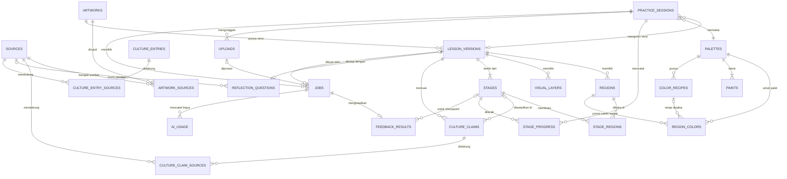
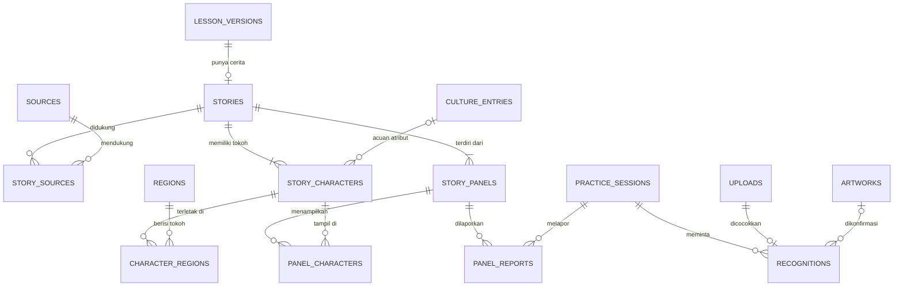

# ERD — Rerupa

Versi: 1.0 · 20 November 2026 · Mengacu ke [PRD v1.3](PRD_Rerupa_v1.3.md) §14 dan [SYSTEM_ARCHITECTURE.md](SYSTEM_ARCHITECTURE.md)

Basis data: **PostgreSQL (Supabase)**. File gambar disimpan di **Supabase Storage**; tabel hanya menyimpan path objek. Semua akses data lewat FastAPI memakai service role — frontend tidak pernah mengakses database langsung (lihat §8).

Konvensi:
- Primary key `uuid` (`gen_random_uuid()`), kecuali disebut lain. ID tidak pernah dipakai sebagai otorisasi.
- Waktu `timestamptz` (UTC). Kolom `created_at` default `now()`; `updated_at` diperbarui trigger.
- Enum Postgres ditulis `snake_case`.
- `(P1)` = tabel/kolom untuk fitur P1; boleh dibuat sejak awal tetapi tidak wajib untuk 27 Nov.
- `*_path` = path objek di bucket Storage (bukan URL publik).

---

## 1. Peta domain

| Domain | Tabel | Keterangan |
| --- | --- | --- |
| Konten budaya & sumber | `sources`, `culture_entries`, `culture_entry_sources`, `content_reviews` | Dikelola Sheva; dasar semua klaim fakta |
| Katalog karya | `artworks`, `artwork_sources` | Materi koleksi + lisensi |
| Palet & warna | `palettes`, `paints`, `color_recipes` | Cat demo, swatch, resep perkiraan/teruji |
| Materi latihan | `lesson_versions`, `regions`, `visual_layers`, `stages`, `stage_regions`, `region_colors`, `culture_claims`, `culture_claim_sources`, `reflection_questions` | Hasil CV + `stage_planner` + teks AI |
| Sesi pengguna | `practice_sessions`, `stage_progress`, `uploads` | Mode tamu, retensi 24 jam |
| Pekerjaan & AI | `jobs`, `feedback_results`, `ai_usage` | Antrean, idempotensi, biaya |
| Pencocokan (P1) | `recognitions` | Kandidat koleksi dari foto |
| Storyline (P1) | `stories`, `story_sources`, `story_characters`, `character_regions`, `story_panels`, `panel_characters`, `panel_reports` | Panel cerita OpenAI image |
| Analitik | `events` | Tanpa gambar/jawaban pribadi |

---

## 2. Diagram relasi

### 2.1 Inti (P0)

### 2.2 Storyline cerita dan pencocokan (P1)

---

## 3. Enum

| Enum | Nilai |
| --- | --- |
| `publish_status` | `draft`, `in_review`, `published`, `archived` |
| `lesson_origin` | `collection`, `free_mode` |
| `lesson_status` | `draft`, `in_review`, `published`, `archived`, `session_private` |
| `license_kind` | `public_domain`, `cc0`, `cc_by`, `cc_by_sa`, `open_data`, `ebt_pending`, `own_work`, `permission_granted`, `unknown` |
| `culture_kind` | `tradition`, `motif`, `technique`, `story`, `character` |
| `claim_type` | `fakta`, `perkiraan` |
| `layer_kind` | `grid`, `lineart`, `main_object`, `regions`, `value` (terang-gelap), `detail_lines`, `original_photo` |
| `lineart_method` | `model`, `xdog`, `canny` |
| `stage_kind` | `preparation`, `sketch`, `background_and_largest`, `main_object`, `medium_regions`, `value`, `small_and_detail`, `finishing` |
| `recipe_kind` | `estimated`, `tested` |
| `progress_status` | `not_started`, `viewed`, `completed` |
| `upload_purpose` | `reference`, `progress` |
| `job_type` | `generate_lesson`, `feedback`, `recognize` (P1), `generate_story` (P1), `generate_panel` (P1) |
| `job_status` | `queued`, `processing`, `succeeded`, `needs_retake`, `failed` |
| `story_status` | `fakta`, `perkiraan`, `tidak_diketahui` |
| `panel_status` | `pending`, `generating`, `ready`, `text_only`, `blocked`, `failed` |
| `panel_source` | `generated`, `artwork_crop` |
| `review_kind` | `rights`, `culture`, `pedagogy`, `recipe`, `panel` |
| `review_decision` | `approved`, `changes_requested`, `rejected` |
| `ai_provider` | `openai`, `deepseek` (opsional, teks saja) |

---

## 4. Kamus data

### 4.1 Konten budaya & sumber

#### `sources`
| Kolom | Tipe | Null | Keterangan |
| --- | --- | --- | --- |
| id | uuid PK | | |
| code | text UNIQUE | | ID stabil yang dirujuk AI, mis. `kb_kamasan_01` |
| title | text | | Judul sumber |
| publisher | text | ya | Penerbit, museum, atau narasumber |
| url | text | ya | |
| note | text | ya | Catatan (mis. wawancara narasumber) |
| license | license_kind | | Lisensi sumber/gambar bila relevan |
| accessed_at | date | | Tanggal akses |
| created_at | timestamptz | | |

#### `culture_entries`
Basis pengetahuan budaya (`culture_kb.json` diimpor ke sini).

| Kolom | Tipe | Null | Keterangan |
| --- | --- | --- | --- |
| id | uuid PK | | |
| code | text UNIQUE | | mis. `kamasan`, `rama` |
| kind | culture_kind | | |
| name | text | | |
| summary | text | | Ringkasan yang boleh dikutip AI |
| attributes | jsonb | | `{required: [...], forbidden: [...]}` — checklist atribut tokoh/motif |
| generation_restricted | boolean | | true = tokoh/adegan tidak boleh digenerate (P1) |
| status | publish_status | | |
| created_at, updated_at | timestamptz | | |

#### `culture_entry_sources`
| Kolom | Tipe | Keterangan |
| --- | --- | --- |
| culture_entry_id | uuid FK → culture_entries | PK gabungan |
| source_id | uuid FK → sources (ON DELETE RESTRICT) | PK gabungan |

#### `content_reviews`
Tinjauan untuk semua objek yang diterbitkan (polimorfik).

| Kolom | Tipe | Null | Keterangan |
| --- | --- | --- | --- |
| id | uuid PK | | |
| subject_type | text | | `artwork`, `lesson_version`, `color_recipe`, `story_panel`, `culture_entry` |
| subject_id | uuid | | |
| kind | review_kind | | |
| reviewer | text | | Nama peninjau/narasumber |
| decision | review_decision | | |
| notes | text | ya | |
| reviewed_at | timestamptz | | |

Indeks: `(subject_type, subject_id)`.

### 4.2 Katalog karya

#### `artworks`
| Kolom | Tipe | Null | Keterangan |
| --- | --- | --- | --- |
| id | uuid PK | | |
| slug | text UNIQUE | | |
| title | text | | |
| artist | text | ya | null = tidak diketahui; tidak boleh ditebak |
| artist_death_year | int | ya | Dasar status public domain |
| tradition | text | ya | mis. Kamasan, Bali |
| region_origin | text | ya | Daerah asal bila bersumber |
| image_path | text | | Bucket `catalog` |
| thumbnail_path | text | | |
| license | license_kind | | |
| license_note | text | ya | Atribusi wajib, mis. "Tropenmuseum, CC BY-SA 3.0" |
| rights_evidence_url | text | ya | Bukti lisensi/izin |
| adaptation_scope | text | ya | mis. "potongan figur kiri, digambar ulang tim" |
| status | publish_status | | |
| created_at, updated_at | timestamptz | | |

Aturan: `status = published` hanya bila `license` ≠ `unknown` dan ada `content_reviews` jenis `rights` yang `approved`. `ebt_pending` hanya boleh `published` setelah konfirmasi (dicatat di review).

#### `artwork_sources`
| Kolom | Tipe | Keterangan |
| --- | --- | --- |
| artwork_id | uuid FK → artworks | PK gabungan |
| source_id | uuid FK → sources | PK gabungan |
| claim_note | text | Klaim apa yang didukung sumber ini |

### 4.3 Palet & warna

#### `palettes`
| Kolom | Tipe | Null | Keterangan |
| --- | --- | --- | --- |
| id | uuid PK | | |
| brand | text | | |
| series | text | | |
| name | text | | |
| is_demo | boolean | | Palet demo resmi |
| created_at | timestamptz | | |

#### `paints`
| Kolom | Tipe | Null | Keterangan |
| --- | --- | --- | --- |
| id | uuid PK | | |
| palette_id | uuid FK → palettes | | |
| code | text | | Kode stabil, mis. `yellow_ochre`; UNIQUE (palette_id, code) |
| name | text | | Nama di kemasan |
| pigment_code | text | ya | mis. PY42 |
| hex | char(7) | | Hex dari swatch terkalibrasi |
| lab | numeric[3] | | CIELAB |
| swatch_path | text | ya | Foto swatch kering |
| measured_at | date | ya | |

#### `color_recipes`
| Kolom | Tipe | Null | Keterangan |
| --- | --- | --- | --- |
| id | uuid PK | | |
| palette_id | uuid FK → palettes | | |
| target_hex | char(7) | | |
| target_lab | numeric[3] | | |
| components | jsonb | | `[{paint_id, parts}]`, parts bilangan bulat |
| delta_e | numeric(5,2) | | ΔE2000 prediksi/ukur terhadap target |
| kind | recipe_kind | | `estimated` (Mixbox) atau `tested` (uji fisik) |
| method | text | | `mixbox_v2`, `physical` |
| correction_tips | jsonb | ya | Cara koreksi |
| swatch_path | text | ya | Wajib bila `tested` |
| tested_at | date | ya | Wajib bila `tested` |
| tested_by | text | ya | Wajib bila `tested` |
| created_at | timestamptz | | |

CHECK: `kind = 'tested'` ⇒ `swatch_path`, `tested_at`, `tested_by` tidak null.

### 4.4 Materi latihan

#### `lesson_versions`
Satu tutorial yang terkunci versinya. Materi koleksi bersifat publik; materi mode bebas milik satu sesi.

| Kolom | Tipe | Null | Keterangan |
| --- | --- | --- | --- |
| id | uuid PK | | |
| artwork_id | uuid FK → artworks | ya | null untuk mode bebas |
| origin | lesson_origin | | |
| owner_session_id | uuid FK → practice_sessions (ON DELETE CASCADE) | ya | Wajib bila `free_mode` |
| version | int | | Naik per perubahan materi koleksi; UNIQUE (artwork_id, version) |
| source_upload_id | uuid FK → uploads (ON DELETE SET NULL) | ya | Foto asal mode bebas |
| medium | text | | `acrylic` |
| level | text | | `beginner` |
| scope | jsonb | | Potongan: `{x, y, w, h}` pada gambar ternormalisasi |
| image_width, image_height | int | | Ruang koordinat semua lapisan |
| use_shading | boolean | | Menentukan layer terang-gelap |
| style | jsonb | | `{technique, complexity}` hasil analisis |
| lineart_method | lineart_method | | Metode yang benar-benar dipakai |
| skill_goal | text | ya | |
| culture_goal | text | ya | |
| checkpoint_count | smallint | | 1 (versi awal) atau 2 (showcase) |
| ai_text_status | text | | `ok`, `template_fallback` |
| prompt_version | text | ya | Versi prompt AI yang dipakai |
| status | lesson_status | | `session_private` untuk mode bebas |
| reviewer | text | ya | Koleksi |
| created_at | timestamptz | | |

CHECK: `origin = 'free_mode'` ⇒ `owner_session_id` not null dan `status = 'session_private'`; `origin = 'collection'` ⇒ `artwork_id` not null.

#### `regions`
| Kolom | Tipe | Null | Keterangan |
| --- | --- | --- | --- |
| id | uuid PK | | |
| lesson_version_id | uuid FK → lesson_versions (CASCADE) | | |
| code | text | | `r01`…; UNIQUE (lesson_version_id, code) — yang dirujuk AI |
| hex | char(7) | | Warna rata region |
| lab | numeric[3] | | |
| area_pct | numeric(6,3) | | Persentase luas |
| bbox | int[4] | | `[x, y, w, h]` |
| centroid | int[2] | | |
| is_main_object | boolean | | Dari mask rembg |
| is_background | boolean | | |
| value_level | smallint | ya | Tingkat terang-gelap 1–5 bila `use_shading` |
| neighbors | text[] | | Kode region tetangga |
| label | text | ya | Nama dari AI, mis. "jubah merah tokoh utama" |
| path_svg | text | | Path SVG (koordinat gambar) |

Indeks: `(lesson_version_id)`.

#### `visual_layers`
| Kolom | Tipe | Null | Keterangan |
| --- | --- | --- | --- |
| id | uuid PK | | |
| lesson_version_id | uuid FK (CASCADE) | | |
| kind | layer_kind | | |
| asset_path | text | | SVG/PNG di bucket `catalog` (koleksi) atau `derived` (mode bebas) |
| format | text | | `svg`, `png` |
| meta | jsonb | ya | mis. `{levels: 4}` untuk `value`, `{cols: 4, rows: 5}` untuk grid |

UNIQUE (lesson_version_id, kind).

#### `stages`
| Kolom | Tipe | Null | Keterangan |
| --- | --- | --- | --- |
| id | uuid PK | | |
| lesson_version_id | uuid FK (CASCADE) | | |
| code | text | | `stage_1`…; UNIQUE (lesson_version_id, code) |
| order_no | smallint | | 1–8; UNIQUE (lesson_version_id, order_no) |
| kind | stage_kind | | Ditetapkan `stage_planner` |
| layers | layer_kind[] | | Lapisan yang tampil di tahap ini |
| is_checkpoint | boolean | | Ditetapkan kode, bukan AI |
| title | text | | Dari AI/templat |
| action | text | | |
| tools | text[] | | |
| done_when | text | | |
| common_mistakes | text[] | | |
| focus_bbox | int[4] | ya | Area zoom untuk foto asli |
| text_source | text | | `ai`, `template`, `curated` |

CHECK: `order_no BETWEEN 1 AND 8`. Aturan aplikasi: 6–8 tahap per versi; jumlah `is_checkpoint` = `lesson_versions.checkpoint_count`.

#### `stage_regions`
Region yang **pertama kali dibuka** di tahap tersebut (tampilan kumulatif dihitung dari order_no).

| Kolom | Tipe | Keterangan |
| --- | --- | --- |
| stage_id | uuid FK → stages (CASCADE) | PK gabungan |
| region_id | uuid FK → regions (CASCADE) | PK gabungan; UNIQUE (region_id) — tiap region dibuka tepat sekali |

#### `region_colors`
Saran warna per region untuk satu palet.

| Kolom | Tipe | Null | Keterangan |
| --- | --- | --- | --- |
| region_id | uuid FK → regions (CASCADE) | | PK gabungan |
| palette_id | uuid FK → palettes | | PK gabungan |
| recipe_id | uuid FK → color_recipes | ya | Resep teruji/perkiraan tersimpan |
| estimate | jsonb | ya | Perkiraan Mixbox on-the-fly: `{components, delta_e}` |
| reachability | text | | `recipe` (ΔE≤3), `estimate` (3–8), `hard` (>8) |
| explanation | text | ya | Teks penjelasan dari AI (tidak mengubah angka) |

CHECK: `recipe_id` atau `estimate` terisi.

#### `culture_claims`
| Kolom | Tipe | Null | Keterangan |
| --- | --- | --- | --- |
| id | uuid PK | | |
| lesson_version_id | uuid FK (CASCADE) | | |
| stage_id | uuid FK → stages | ya | null = tampil di detail karya |
| text | text | | |
| type | claim_type | | |
| order_no | smallint | | |

Aturan: `type = 'fakta'` wajib punya ≥1 baris di `culture_claim_sources` (divalidasi aplikasi + trigger deferred).

#### `culture_claim_sources`
| Kolom | Tipe | Keterangan |
| --- | --- | --- |
| claim_id | uuid FK → culture_claims (CASCADE) | PK gabungan |
| source_id | uuid FK → sources (ON DELETE RESTRICT) | PK gabungan — sumber tidak bisa dihapus diam-diam |

#### `reflection_questions`
| Kolom | Tipe | Null | Keterangan |
| --- | --- | --- | --- |
| id | uuid PK | | |
| lesson_version_id | uuid FK UNIQUE (CASCADE) | | Satu per versi |
| question | text | | |
| options | jsonb | | Pilihan jawaban |
| correct_option | smallint | | |
| answer_source_id | uuid FK → sources | | Jawaban harus diajarkan & bersumber |

### 4.5 Sesi pengguna

#### `practice_sessions`
| Kolom | Tipe | Null | Keterangan |
| --- | --- | --- | --- |
| id | uuid PK | | Acak; tidak dipakai sebagai otorisasi |
| token_hash | bytea UNIQUE | | SHA-256 dari token di cookie httpOnly |
| lesson_version_id | uuid FK → lesson_versions | ya | Versi yang dikunci (null sebelum tutorial siap) |
| palette_id | uuid FK → palettes | | |
| canvas_size | text | | `A4`, `A3`, `30x40` |
| current_stage_order | smallint | | |
| consent | jsonb | | `{ai_photo: bool, at: timestamptz, text_version: "v1"}` |
| quotas | jsonb | | Penghitung: `{generate: 0, checkpoint: 0, retry: 0}` |
| safety_id | text | | Hash untuk `safety_identifier` OpenAI |
| created_at | timestamptz | | |
| last_seen_at | timestamptz | | |
| expires_at | timestamptz | | created_at + 7 hari |
| deleted_at | timestamptz | ya | Diisi saat "hapus sesi" → akses dicabut seketika |

Indeks: `(expires_at)`, `(deleted_at)` untuk pembersih.

#### `stage_progress`
| Kolom | Tipe | Null | Keterangan |
| --- | --- | --- | --- |
| session_id | uuid FK (CASCADE) | | PK gabungan |
| stage_id | uuid FK → stages | | PK gabungan |
| status | progress_status | | Melihat ≠ menyelesaikan |
| completed_at | timestamptz | ya | |

#### `uploads`
| Kolom | Tipe | Null | Keterangan |
| --- | --- | --- | --- |
| id | uuid PK | | |
| session_id | uuid FK (CASCADE) | | |
| purpose | upload_purpose | | |
| stage_id | uuid FK → stages | ya | Wajib bila `progress` |
| raw_path | text | ya | Bucket `uploads`; null setelah dihapus |
| normalized_path | text | ya | Bucket `derived` |
| rectified_path | text | ya | Hasil warp 4 sudut (progress) |
| corners | int[8] | ya | 4 titik sudut dari tap pengguna |
| sha256 | bytea | | Untuk cache hasil identik |
| mime | text | | Hasil cek magic bytes |
| width, height | int | | |
| quality | jsonb | ya | `{blur, brightness, glare, usable}` |
| sent_to_ai | boolean | | Apakah foto pernah dikirim ke OpenAI |
| expires_at | timestamptz | | created_at + 24 jam |
| purged_at | timestamptz | ya | Diisi pembersih |
| created_at | timestamptz | | |

Indeks: `(expires_at) WHERE purged_at IS NULL`, `(session_id)`, `(sha256)`.

### 4.6 Pekerjaan & AI

#### `jobs`
| Kolom | Tipe | Null | Keterangan |
| --- | --- | --- | --- |
| id | uuid PK | | |
| session_id | uuid FK (CASCADE) | | |
| type | job_type | | |
| idempotency_key | text | | Dari header `Idempotency-Key` |
| payload_hash | bytea | | Hash payload; kunci sama + hash beda → 409 |
| status | job_status | | |
| upload_id | uuid FK → uploads | ya | |
| stage_id | uuid FK → stages | ya | Untuk feedback |
| lesson_version_id | uuid FK → lesson_versions | ya | Hasil `generate_lesson` |
| story_id | uuid | ya | (P1) |
| progress | jsonb | ya | `{step: "cv" | "planning" | "writing", pct}` untuk UI |
| attempts | smallint | | |
| error_code | text | ya | Kode yang dipetakan ke pesan pengguna |
| locked_by | text | ya | ID worker |
| locked_at | timestamptz | ya | |
| started_at, finished_at | timestamptz | ya | |
| created_at | timestamptz | | |

UNIQUE (session_id, type, idempotency_key). Indeks: `(status, created_at) WHERE status = 'queued'` untuk klaim worker.

#### `feedback_results`
| Kolom | Tipe | Null | Keterangan |
| --- | --- | --- | --- |
| job_id | uuid PK FK → jobs (CASCADE) | | |
| stage_id | uuid FK → stages | | Checkpoint yang dinilai |
| image_quality | text | | `usable`, `poor` |
| alignment | text | | `confirmed`, `failed` |
| needs_retake | boolean | | |
| metrics | jsonb | | Metrik per region dari CV |
| candidates | jsonb | | Kandidat masalah yang dikirim ke AI |
| suggestions | jsonb | | Maks 2: `[{region_code, observation, action}]` |
| marker_bboxes | jsonb | ya | Hanya bila alignment `confirmed` |
| created_at | timestamptz | | |

Teks feedback tetap ada setelah foto dihapus (sampai sesi berakhir).

#### `ai_usage`
| Kolom | Tipe | Null | Keterangan |
| --- | --- | --- | --- |
| id | uuid PK | | |
| job_id | uuid FK → jobs (SET NULL) | ya | |
| provider | ai_provider | | |
| model | text | | Nama model sebenarnya |
| task | text | | `stage_text`, `feedback`, `storyboard`, `panel`, `panel_check` |
| input_tokens, output_tokens, cached_tokens | int | | |
| image_count | int | | Untuk image generation |
| cost_usd | numeric(10,5) | | Dihitung dari tabel harga di config |
| latency_ms | int | | |
| outcome | text | | `ok`, `retry`, `refusal`, `truncated`, `schema_error`, `timeout` |
| created_at | timestamptz | | |

Dipakai untuk batas pengeluaran harian di sisi aplikasi (selain batas di dashboard OpenAI).

### 4.7 Pencocokan koleksi (P1)

#### `recognitions`
| Kolom | Tipe | Null | Keterangan |
| --- | --- | --- | --- |
| id | uuid PK | | |
| session_id | uuid FK (CASCADE) | | |
| upload_id | uuid FK → uploads | | |
| job_id | uuid FK → jobs | | |
| candidates | jsonb | | `[{artwork_id, inliers}]` — bukan probabilitas |
| decision | text | | `matched`, `ambiguous`, `no_match` |
| confirmed_artwork_id | uuid FK → artworks | ya | Diisi setelah pengguna mengonfirmasi |
| created_at | timestamptz | | |

### 4.8 Storyline cerita (P1)

#### `stories`
| Kolom | Tipe | Null | Keterangan |
| --- | --- | --- | --- |
| id | uuid PK | | |
| lesson_version_id | uuid FK UNIQUE (CASCADE) | | Maks satu storyline per tutorial |
| title | text | | |
| status | story_status | | |
| summary | text | | |
| style_guide | text | | Dipakai di semua prompt panel |
| prompt_version | text | | |
| created_at | timestamptz | | |

Aturan: `status = 'fakta'` wajib punya `story_sources`.

#### `story_sources`
| Kolom | Tipe | Keterangan |
| --- | --- | --- |
| story_id | uuid FK (CASCADE) | PK gabungan |
| source_id | uuid FK → sources (RESTRICT) | PK gabungan |

#### `story_characters`
| Kolom | Tipe | Null | Keterangan |
| --- | --- | --- | --- |
| id | uuid PK | | |
| story_id | uuid FK (CASCADE) | | |
| code | text | | UNIQUE (story_id, code) |
| name | text | | |
| lock_description | text | | Deskripsi terkunci, diulang di setiap prompt |
| culture_entry_id | uuid FK → culture_entries | ya | Sumber checklist atribut |
| reference_crop_path | text | ya | Potongan tokoh dari karya asli |

#### `character_regions`
| Kolom | Tipe | Keterangan |
| --- | --- | --- |
| character_id | uuid FK (CASCADE) | PK gabungan |
| region_id | uuid FK → regions (CASCADE) | PK gabungan — dasar tautan "lukis tokoh ini" |

#### `story_panels`
| Kolom | Tipe | Null | Keterangan |
| --- | --- | --- | --- |
| id | uuid PK | | |
| story_id | uuid FK (CASCADE) | | |
| order_no | smallint | | UNIQUE (story_id, order_no); 1–6 |
| narration | text | | ≤40 kata |
| scene | text | | |
| source | panel_source | | `artwork_crop` untuk adegan yang ada di karya |
| prompt | text | ya | Prompt final ke OpenAI |
| provider | ai_provider | ya | |
| model | text | ya | mis. `gpt-image-2.6-sunburst` |
| response_id | text | ya | `previous_response_id` untuk panel berikutnya |
| image_path | text | ya | |
| status | panel_status | | |
| check_result | jsonb | ya | Hasil pemeriksa konsistensi & budaya |
| regen_count | smallint | | Maks 1 |
| created_at | timestamptz | | |

#### `panel_characters`
| Kolom | Tipe | Keterangan |
| --- | --- | --- |
| panel_id | uuid FK (CASCADE) | PK gabungan |
| character_id | uuid FK (CASCADE) | PK gabungan |

#### `panel_reports`
| Kolom | Tipe | Null | Keterangan |
| --- | --- | --- | --- |
| id | uuid PK | | |
| panel_id | uuid FK (CASCADE) | | |
| session_id | uuid FK (SET NULL) | ya | |
| reason | text | | Pilihan tetap, bukan teks bebas pribadi |
| created_at | timestamptz | | |

### 4.9 Analitik

#### `events`
| Kolom | Tipe | Null | Keterangan |
| --- | --- | --- | --- |
| id | bigint identity PK | | |
| session_ref | bytea | | Hash sesi (bukan ID mentah) |
| name | text | | `lesson_viewed`, `practice_started`, `stage_completed`, `recipe_opened`, `original_photo_opened`, `checkpoint_requested`, `feedback_shown`, `lesson_completed`, `reflection_answered`, `session_deleted`; P1: `recognition_confirmed`, `story_opened` |
| props | jsonb | | Hanya ID teknis (stage order, lesson origin), tanpa gambar/jawaban bebas |
| created_at | timestamptz | | |

Indeks: `(name, created_at)`.

---

## 5. Aturan integritas lintas tabel

| Aturan | Ditegakkan oleh |
| --- | --- |
| Tahapan kumulatif dan semua region tercakup | `stage_planner` + UNIQUE `stage_regions.region_id` + cek aplikasi "jumlah region = jumlah baris stage_regions" |
| 6–8 tahap; jumlah checkpoint sesuai `checkpoint_count` | Validator aplikasi sebelum commit transaksi |
| Klaim `fakta` wajib bersumber | Validator + trigger deferred di `culture_claims` |
| Sumber tidak bisa dihapus bila masih dirujuk | FK `ON DELETE RESTRICT` dari `*_sources` |
| Resep `tested` lengkap datanya | CHECK di `color_recipes` |
| Materi mode bebas privat milik sesi | CHECK di `lesson_versions` + filter `owner_session_id` di semua query |
| Sesi mengunci versi materi | `practice_sessions.lesson_version_id` merujuk versi spesifik, bukan artwork |
| Idempotensi job | UNIQUE (session_id, type, idempotency_key) + perbandingan `payload_hash` |
| Feedback hanya untuk tahap checkpoint | Cek aplikasi: `stages.is_checkpoint = true` |

---

## 6. Siklus hidup & retensi data

| Data | Masa simpan | Mekanisme |
| --- | --- | --- |
| `uploads` (file mentah, ternormalisasi, rectified) | ≤24 jam | `pg_cron` tiap 15 menit: hapus objek Storage, isi `purged_at`, null-kan path |
| Lapisan visual mode bebas (`derived`) | Sampai sesi berakhir (≤7 hari) | Ikut CASCADE dari `lesson_versions` saat sesi dibersihkan |
| `practice_sessions` | 7 hari atau sampai "hapus sesi" | `deleted_at` → akses dicabut seketika; pembersih menghapus baris ≤24 jam kemudian (CASCADE ke progress, uploads, jobs, lesson mode bebas) |
| `feedback_results` | Sampai sesi berakhir | CASCADE dari `jobs` |
| `ai_usage` | 90 hari | Tanpa isi prompt; `job_id` di-SET NULL saat job dihapus |
| `events` | 180 hari | Hanya hash sesi |
| Katalog (`artworks`, materi koleksi, resep, sumber) | Permanen, berversi | Arsip lewat `status = archived` |

Pelaksanaan retensi otomatis boleh menyusul setelah 27 Nov, tetapi wajib sebelum uji dengan data pengguna nyata di luar tim (PRD §17).

---

## 7. Indeks penting

| Tabel | Indeks | Untuk |
| --- | --- | --- |
| jobs | `(status, created_at) WHERE status='queued'` | Klaim worker `FOR UPDATE SKIP LOCKED` |
| jobs | UNIQUE `(session_id, type, idempotency_key)` | Idempotensi |
| uploads | `(expires_at) WHERE purged_at IS NULL` | Pembersih retensi |
| uploads | `(sha256)` | Cache hasil identik |
| practice_sessions | UNIQUE `(token_hash)` | Autentikasi sesi |
| regions | `(lesson_version_id)` | Muat tutorial |
| stages | UNIQUE `(lesson_version_id, order_no)` | Navigasi tahap |
| ai_usage | `(created_at)` | Total biaya harian |
| events | `(name, created_at)` | Metrik |

---

## 8. Keamanan data

- **Row Level Security aktif** di semua tabel tanpa policy untuk role `anon`/`authenticated` → hanya service role (FastAPI) yang bisa membaca/menulis.
- Bucket Storage: `catalog` (privat; dibaca lewat signed URL berumur panjang atau CDN untuk aset terbit), `uploads` dan `derived` (privat; signed URL ≤5 menit, hanya untuk pemilik sesi).
- Setiap query data sesi difilter oleh `session_id` hasil verifikasi `token_hash` — bukan dari ID di URL.

---

## 9. Pemetaan ke PRD v1.3 §14

| Entitas PRD | Tabel |
| --- | --- |
| Artwork | `artworks`, `artwork_sources` |
| LessonVersion | `lesson_versions` |
| CultureEntry | `culture_entries`, `culture_entry_sources` |
| Story / StoryPanel (P1) | `stories`, `story_characters`, `story_panels` (+ tabel penghubung) |
| Stage | `stages`, `stage_regions` |
| VisualLayer | `visual_layers` (+ `regions` untuk region graph) |
| Palette | `palettes`, `paints` |
| ColorRecipe | `color_recipes`, `region_colors` |
| Source | `sources` |
| PracticeSession | `practice_sessions`, `stage_progress` |
| ProgressUpload | `uploads` (purpose `progress`) |
| FeedbackJob | `jobs` (type `feedback`) + `feedback_results` |
| ContentReview | `content_reviews` |
| (tambahan) | `culture_claims`, `reflection_questions`, `ai_usage`, `recognitions` (P1), `events` |

## 10. Urutan migrasi yang disarankan

1. Enum + `sources`, `culture_entries`, `artworks`, `palettes`, `paints`, `color_recipes`, `content_reviews` (konten; Sheva bisa mulai mengisi).
2. `practice_sessions`, `uploads`, `jobs`, `ai_usage` (fondasi API — 21 Nov).
3. `lesson_versions`, `regions`, `visual_layers`, `stages`, `stage_regions`, `region_colors`, `culture_claims`, `reflection_questions` (pipeline tahapan — 22–23 Nov).
4. `stage_progress`, `feedback_results`, `events` (checkpoint & progres — 25–26 Nov).
5. Retensi `pg_cron` (28 Nov–4 Des).
6. P1: `recognitions`, `stories`, `story_*`, `panel_*`.
