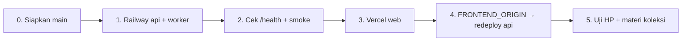

# Rencana Deploy Rerupa (Backend + Frontend)

Dibuat 21 Nov 2026. Acuan teknis backend: [api/DEPLOY.md](api/DEPLOY.md). Arsitektur: [SYSTEM_ARCHITECTURE.md §12](SYSTEM_ARCHITECTURE.md).

## Ringkasan

| Bagian | Platform | Sumber | Catatan |
| --- | --- | --- | --- |
| API (FastAPI) | Railway, Singapura | `api/` + `Dockerfile.api` | 0,5 vCPU / 512 MB, **1 instance**, domain publik |
| Worker (CV + OpenAI) | Railway, Singapura | `api/` + `Dockerfile.worker` | 2 vCPU / 3 GB, tanpa domain |
| Web (Next.js 15) | Vercel | `web/` | Root Directory `web`, framework Next.js |
| Database + Storage | Supabase Singapura | `supabase/migrations/` | Sudah jalan |

Semua dari repo `iqbalvrd/Rerupa`, cabang `main`. Push ke `main` = deploy otomatis di kedua platform.

**Urutan wajib: backend dulu, frontend kemudian.** `NEXT_PUBLIC_API_BASE_URL` ditanam ke kode saat `next build`, jadi domain API harus ada sebelum build Vercel. Setelah domain Vercel ada, `FRONTEND_ORIGIN` di API diisi dan API di-redeploy.



## Keputusan sebelum mulai

| # | Keputusan | Pilihan | Saran |
| --- | --- | --- | --- |
| K1 | Fase 8 (storyline) ikut deploy pertama? | Ya / nanti | **Nanti.** Deploy `main` yang sudah stabil dulu; Fase 8 masuk lewat PR terpisah dengan `FEATURE_STORY=false` sampai siap |
| K2 | Domain | Bawaan (`*.vercel.app` + `*.up.railway.app`) / domain sendiri (`rerupa.id` + `api.rerupa.id`) | **Bawaan dulu**, uji Safari iPhone. Pindah ke domain sendiri bila cookie sesi diblokir |
| K3 | Batas biaya AI | `DAILY_AI_BUDGET_USD` | `5` + monthly budget di dashboard OpenAI |

Tentang K2: domain bawaan berarti frontend dan API beda situs, cookie `rerupa_session` jadi cookie pihak ketiga. Chrome/Android aman; Safari iOS bisa memblokir. Domain sendiri dengan subdomain (`api.` di bawah domain yang sama) membuat cookie jadi pihak pertama di semua browser. Proxy `/api` lewat Vercel **tidak dipakai** karena unggahan foto sampai 10 MB.

## Langkah 0 — Siapkan `main`

- [ ] Branch lokal sudah tertinggal 15 commit dari `origin/main` (frontend `web/` dari Xavier). `git fetch` lalu pastikan bekerja di atas `origin/main`.
- [ ] Bila K1 = nanti: simpan Fase 8 di `feat/fase-8-storyline` (commit, rebase ke `origin/main`), jangan merge dulu.
- [ ] Cek migrasi di `supabase/migrations/` yang ada di `main` sudah diterapkan ke project Supabase produksi (bandingkan dengan daftar migrasi di dashboard).
- [ ] Siapkan key baru: `OPENAI_API_KEY` dan rotasi `SUPABASE_SERVICE_ROLE_KEY` (yang pernah ditempel di chat dicabut).
- [ ] `cd web && npm ci && npm run check && npm run build` lulus di lokal.
- [ ] `cd api && uv run pytest` lulus.

## Langkah 1 — Railway (backend)

1. New Project → Deploy from GitHub → `iqbalvrd/Rerupa`.
2. Service **api**: Root Directory `api`, region Singapura, Networking → Generate Domain.
3. Service **worker**: repo sama, Root Directory `api`, Dockerfile `Dockerfile.worker`, draining 60 s, region Singapura, tanpa domain. Bila build gagal unduh model Hugging Face → variabel build `HF_TOKEN`.
4. Shared Variables (rahasia diisi pemilik akun di dashboard, bukan lewat chat):

| Variabel | api | worker | Nilai |
| --- | --- | --- | --- |
| `ENVIRONMENT` | ✅ | ✅ | `production` |
| `SUPABASE_URL` | ✅ | ✅ | URL project Singapura |
| `SUPABASE_SERVICE_ROLE_KEY` | ✅ | ✅ | **rahasia** |
| `OPENAI_API_KEY` | ✅ | ✅ | **rahasia** |
| `OPENAI_VISION_MODEL`, `OPENAI_TEXT_MODEL` | ✅ | ✅ | `gpt-6.1-terra` |
| `OPENAI_PRICE_INPUT_PER_M` / `_OUTPUT_PER_M` | ✅ | ✅ | `1.0` / `5.0` |
| `OPENAI_REASONING_EFFORT` | ✅ | ✅ | `low` |
| `DAILY_AI_BUDGET_USD` | ✅ | ✅ | `5` |
| `FRONTEND_ORIGIN` | ✅ | | sementara `http://localhost:3000`, diganti di Langkah 4 |
| `COOKIE_SAMESITE` / `COOKIE_SECURE` | ✅ | | `none` / `true` (domain bawaan). Domain sendiri: `lax` / `true` |
| `TRUST_PROXY_HEADERS` | ✅ | | `true` |
| `EXPOSE_DOCS` | ✅ | | `false` |
| `CHECKPOINT_COUNT` | | ✅ | `2` |
| `WORKER_CONCURRENCY` | | ✅ | `2` |
| `LINEART_METHOD`, `MASK_MODEL` | | ✅ | `teed`, `u2net` |

5. Deploy. Build pertama worker ±2–2,5 GB, butuh waktu; ini juga uji pertama Dockerfile (belum pernah di-build lokal).

## Langkah 2 — Cek backend

- [ ] `https://<api>.up.railway.app/health` → `status: ok`, `supabase: ok`, `environment: production`.
- [ ] Log worker menunjukkan model selesai dimuat (±30–70 s setelah start).
- [ ] Smoke test dari laptop:
  ```bash
  cd api && uv run --group cv python scripts/smoke.py --base-url https://<api>.up.railway.app
  ```

## Langkah 3 — Vercel (frontend)

1. Add New Project → import `iqbalvrd/Rerupa` → **Root Directory `web`**, Framework Next.js (build `npm run build`, output bawaan).
2. Environment Variables (Production + Preview):

| Variabel | Nilai |
| --- | --- |
| `NEXT_PUBLIC_API_BASE_URL` | `https://<api>.up.railway.app` (tanpa `/` di akhir) |

   Jangan isi `NEXT_PUBLIC_GALLERY_SOURCE` atau `NEXT_PUBLIC_API_MOCK` di produksi.
3. Function region `sin1` (Settings → Functions) agar dekat dengan API.
4. Deploy, catat domain produksi (mis. `https://rerupa.vercel.app`).

## Langkah 4 — Sambungkan balik

- [ ] Service api Railway: `FRONTEND_ORIGIN=https://<web>.vercel.app` (beberapa dipisah koma bila ada domain sendiri).
- [ ] Opsional preview Vercel: `FRONTEND_ORIGIN_REGEX=^https://<project>-[a-z0-9-]+-<scope>\.vercel\.app$`.
- [ ] Redeploy api. Cek dari browser: devtools → request ke API tidak kena CORS, respons membawa `Set-Cookie` `rerupa_session`.

## Langkah 5 — Uji akhir

- [ ] Terbitkan minimal 1 materi koleksi:
  ```bash
  cd api && uv run --group cv python scripts/import_collection.py ../content/artworks/<slug> --publish
  ```
- [ ] Alur di HP Android (Chrome) dan iPhone (Safari): galeri → detail karya → persiapan → latihan → checkpoint foto → feedback; mode bebas: unggah foto → tutorial.
- [ ] Safari iPhone: muat ulang halaman, sesi tetap ada. Bila sesi hilang → eksekusi K2 domain sendiri.
- [ ] Set monthly budget + notifikasi di dashboard OpenAI.
- [ ] Ukur P95 produksi (lihat [api/DEPLOY.md §5](api/DEPLOY.md)) → `eval/P95_PRODUKSI.md`.
- [ ] Perbarui [HANDOFF.md](HANDOFF.md): URL API produksi, domain Vercel, status Fase 6 ✅.

## Bila memakai domain sendiri (K2)

1. Vercel → Domains: `rerupa.id` (atau `app.`), ikuti record DNS dari Vercel.
2. Railway service api → Custom Domain `api.rerupa.id`, tambahkan CNAME dari Railway.
3. `NEXT_PUBLIC_API_BASE_URL=https://api.rerupa.id` → redeploy Vercel.
4. API: `FRONTEND_ORIGIN=https://rerupa.id`, `COOKIE_SAMESITE=lax` → redeploy api.

## Rollback & pemantauan

- Vercel: Deployments → deployment sebelumnya → Promote to Production (instan).
- Railway: Deployments → deployment sebelumnya → Redeploy. Worker menyelesaikan job berjalan dulu (draining 60 s).
- Pantau log Railway: `job_finished`, `overdue_jobs_failed`, `ai_budget_warning`, `unhandled_error`. `/health` `degraded` = antrean macet (worker mati/kewalahan).

## Sebelum demo / showcase

- Deploy terakhir **≥2 menit** sebelum dipakai (worker memuat model), lalu jalankan smoke test sekali untuk memanaskan cache.
- Jangan push ke `main` saat demo berlangsung (memicu redeploy kedua platform).
- API tetap 1 instance (rate limit di memori).
