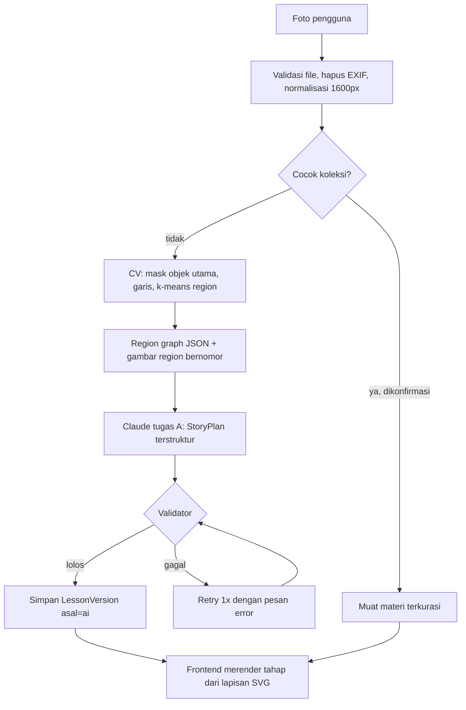
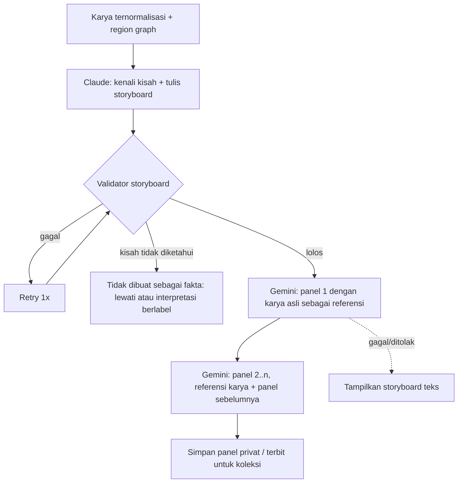

# Rencana Pengerjaan — Rerupa (AI Mentor Melukis Seni Nusantara)

Versi: 1.1 · 20 November 2026 · Mengacu ke [PRD v1.2](PRD_AI_Mentor_Melukis_Seni_Nusantara_v1.2.md)

Dokumen ini menjawab lima hal: **framework apa**, **model AI apa**, **bagaimana LLM diubah menjadi tahapan visual melukis**, **bagaimana storyline cerita dibuat dengan image generation**, dan **bagaimana aplikasi mengajarkan melukis**. Setelah itu ada fase pengerjaan yang detail.

Dua jenis visual yang berbeda:
- **Tahapan melukis** (tutorial 6–8 tahap): dirakit dari lapisan hasil olahan foto, **tanpa** image generation, agar bentuk sama persis di setiap tahap.
- **Storyline cerita** (4–6 panel kisah di balik karya): dibuat dengan **Gemini image generation**, memakai karya asli sebagai referensi gaya dan tokoh.

---

## 1. Prinsip arsitektur (paling penting)

> **LLM tidak menggambar. LLM merencanakan dan menjelaskan; gambar dibuat oleh pengolahan citra yang deterministik.**

Kalau tiap tahap dibuat dengan model gambar generatif, bentuk figur akan bergeser antar tahap dan panduan jadi tidak bisa diikuti. Jadi pembagian kerjanya:

| Pekerjaan | Dikerjakan oleh | Alasan |
| --- | --- | --- |
| Memecah foto jadi garis, objek, bidang warna | Computer vision (OpenCV, rembg) | Hasil konsisten, koordinat sama untuk semua tahap |
| Memilih urutan tahap, mengelompokkan bidang, menulis instruksi | Claude (vision + structured output) | Butuh pemahaman gaya, teknik, dan bahasa pengajaran |
| Merender gambar tiap tahap | Renderer SVG di frontend | Tahap N = tumpukan lapisan sampai tahap N |
| Menghitung campuran cat | Algoritma pencampuran pigmen + data swatch | Rasio tidak boleh ditebak LLM |
| Mengukur selisih foto progres vs target | Computer vision (warp + perbandingan per region) | Angka terukur, bukan tebakan |
| Menulis feedback dan konteks budaya | Claude | Bahasa yang jelas, dibatasi data terukur dan sumber |
| Mengenali kisah dan menulis storyboard cerita | Claude | Butuh pemahaman budaya + aturan sumber |
| Menggambar panel cerita | Gemini image generation | Ilustrasi kisah tidak harus sama persis bentuknya dengan karya |

---

## 2. Tech stack

### 2.1 Ringkasan

| Lapisan | Pilihan | Catatan |
| --- | --- | --- |
| Frontend | **Next.js 15 (App Router) + TypeScript + Tailwind CSS** | Mobile-first, deploy mudah di Vercel |
| Komponen UI | shadcn/ui (Radix) | Aksesibel (keyboard, screen reader) sesuai PRD §12 |
| Render tahap & lapisan | **SVG** (React) + `react-zoom-pan-pinch` | Vektor, tajam di semua ukuran, mudah ditumpuk/diwarnai |
| State klien | Zustand + TanStack Query | Polling status job tiap 1 detik |
| Kamera | `getUserMedia` + fallback `<input type="file" accept="image/*" capture>` | Akses kamera hanya setelah tap pengguna |
| Backend API + worker | **Python 3.12 + FastAPI** | Satu bahasa untuk CV dan pemanggilan Claude |
| Computer vision | OpenCV, scikit-image, scikit-learn, **rembg** (U²-Net), Pillow | Semua model pretrained, tanpa training |
| Pencampuran warna | **Mixbox** (model pigmen Kubelka–Munk) + `colour-science` (ΔE2000) | Mixbox berlisensi CC BY-NC: aman untuk hackathon, perlu lisensi untuk komersial |
| LLM | **Anthropic Python SDK** (`anthropic`) → `claude-opus-5-5` | Lihat §3 |
| Image generation | **Google Gen AI Python SDK** (`google-genai`) → Gemini image model | Lihat §3.2; API key menyusul |
| Validasi | Pydantic v2 (backend), Zod (frontend) | Skema yang sama dipakai untuk structured output |
| Database + storage | **Supabase** (Postgres + Storage bucket privat + signed URL) | `pg_cron` untuk hapus foto ≤24 jam |
| Antrean job | Tabel `jobs` di Postgres + worker FastAPI (`asyncio`) | Cukup untuk skala hackathon; idempotency key di tabel |
| Deploy | Vercel (frontend), Railway/Fly.io (FastAPI, butuh OpenCV) | Region Singapura untuk latensi Indonesia |
| Observasi | Log terstruktur tanpa foto/prompt (PRD §17), event analitik ke tabel `events` | |

### 2.2 Kenapa bukan "semua di Next.js"?

OpenCV, rembg, dan Mixbox paling matang di Python. Memaksakan semuanya di Node (opencv.js, onnxruntime-node) memakan waktu debug yang tidak sepadan dalam 48 jam. Next.js hanya jadi frontend dan memanggil FastAPI.

### 2.3 Struktur repo

```
rerupa/
├─ web/                    # Next.js
│  ├─ app/                 # beranda, galeri, latihan/[sessionId], checkpoint, selesai
│  ├─ components/stage/    # StageCanvas (SVG), LayerToggle, StageSlider, ColorRecipeCard
│  └─ lib/schemas.ts       # Zod, disinkronkan dari skema Pydantic
├─ api/                    # FastAPI
│  ├─ routes/              # artworks, recognitions, lessons, sessions, checkpoints, jobs
│  ├─ cv/                  # normalize, recognize, layers, regions, align, compare
│  ├─ ai/                  # claude_client, prompts/, schemas.py, validators.py
│  ├─ story/               # storyboard (Claude), gemini_client, panel_store, placeholder
│  ├─ color/               # palette, mixer (Mixbox), deltaE
│  └─ worker.py            # pemroses job + pembersih retensi
├─ content/
│  ├─ artworks/            # 3–5 materi koleksi (gambar, lapisan, tahap, sumber)
│  ├─ culture_kb.json      # basis pengetahuan budaya + sumber
│  └─ palette_demo.json    # cat demo + hex swatch terukur
└─ eval/                   # foto uji positif/negatif, pasangan progres-target, skrip evaluasi
```

---

## 3. Model AI yang dipakai

### 3.1 LLM: Claude Opus 5.5 (`claude-opus-5-5`)

Satu model untuk semua tugas bahasa + vision. Konfigurasi per tugas:

| Tugas | Input | Output | `effort` | Perkiraan biaya/panggilan* |
| --- | --- | --- | --- | --- |
| **A. Rencana tahapan** | Foto ternormalisasi + gambar region berlabel nomor + tabel region (JSON) + palet + basis budaya | `StoryPlan` (JSON terstruktur) | `high` | ± Rp3.000–4.000 |
| **B. Feedback checkpoint** | Foto progres yang sudah diluruskan + target tahap + metrik selisih per region | `Feedback` (maks 2 saran) | `medium` | ± Rp1.000–1.500 |
| **D. Storyboard cerita** | Karya + region graph + basis budaya | `Storyboard` (kisah, tokoh terkunci, 4–6 panel) | `medium` | ± Rp1.000–2.000 |
| **C. Tanya per langkah (P1)** | Tahap aktif + pertanyaan | Jawaban singkat | `low` | ± Rp300 |

\*Kasar, dengan harga Opus 5.5 $4/$20 per juta token dan kurs ±Rp16.000. Basis budaya dan instruksi sistem diberi **prompt caching** sehingga hanya dibayar penuh sekali.

Pengaturan wajib:
- **Structured outputs** (`client.messages.parse(...)` dengan model Pydantic) supaya keluaran pasti sesuai skema.
- **Adaptive thinking** (bawaan Opus 5.5; tidak bisa dimatikan) — kedalamannya diatur lewat `output_config.effort`.
- **Streaming** untuk tugas A (keluaran panjang) dengan `.get_final_message()`.
- **Server-side fallback** (`fallbacks: "default"` + beta `server-side-fallback-2026-07-01`) agar penolakan model tidak memutus alur.
- Cek `stop_reason` (`refusal`, `max_tokens`) sebelum membaca hasil.
- Kunci API hanya di FastAPI.

Kalau biaya ternyata terlalu besar saat uji, kandidat penggantinya Claude Sonnet 5.5 untuk tugas B dan C — tapi keputusan itu diambil setelah mengukur kualitas, bukan di awal.

### 3.2 Image generation: Google Gemini

| Hal | Keputusan |
| --- | --- |
| Model | Model image Gemini terbaru yang mendukung **gambar referensi + edit + konsistensi tokoh** (keluarga "Gemini Flash Image"). Nama model persis dan harganya dicek saat API key tersedia, lalu disimpan di env `GEMINI_IMAGE_MODEL` agar mudah diganti |
| SDK | `google-genai` (Python), dipanggil hanya dari FastAPI |
| Kunci | `GEMINI_API_KEY` di secret manager; **menyusul** — sampai tersedia, `story/placeholder.py` mengembalikan panel placeholder berlabel "contoh" agar UI dan alur bisa dikerjakan |
| Tier | Tier berbayar (data tier gratis dapat dipakai Google untuk peningkatan layanan) |
| Referensi | Karya asli (ternormalisasi, EXIF dihapus) + panel sebelumnya sebagai referensi tambahan untuk konsistensi tokoh |
| Resolusi | Panel 1024×768 (landscape) atau 768×1024 sesuai orientasi karya |
| Biaya | Maks 6 panel + 1 regenerasi per panel per tutorial; panel materi koleksi di-cache selamanya |

### 3.3 Model computer vision (semua pretrained, tanpa training)

| Kebutuhan | Model / algoritma |
| --- | --- |
| Objek utama | **rembg** (U²-Net) untuk saliency mask; cadangan: GrabCut |
| Garis bantu (line art) | XDoG / Canny + penghalusan, lalu `findContours` + `approxPolyDP` → path SVG |
| Bidang warna | Bilateral/mean-shift filter → **k-means di ruang CIELAB** (6–12 warna) → connected components → gabung region kecil → path SVG |
| Pencocokan koleksi | ORB/AKAZE + homografi RANSAC (jumlah inlier sebagai skor) + perceptual hash sebagai saringan awal |
| Kualitas foto | Varians Laplacian (buram), histogram (gelap/silau), rasio area bidang |
| Pelurusan foto progres | Deteksi kuadrilateral terbesar → `warpPerspective`; cadangan: pengguna tap 4 sudut |
| Penyelarasan halus | ECC (`findTransformECC`) terhadap garis target |
| Selisih per region | IoU siluet, persentase region yang sudah terisi, selisih luminans L* rata-rata per region |

---

## 4. Integrasi LLM → tahapan visual melukis

### 4.1 Alur pipeline



### 4.2 Apa yang dihasilkan CV (masukan ke Claude)

```json
{
  "image": { "width": 1200, "height": 1600 },
  "regions": [
    { "id": "r07", "hex": "#B5532E", "lab": [48, 38, 40], "area_pct": 6.2,
      "bbox": [310, 420, 520, 900], "is_main_object": true, "neighbors": ["r03", "r11"] }
  ],
  "line_layer": { "path_count": 214, "density": "tinggi" },
  "palette_hint": ["#1E1A17", "#B5532E", "#D9B66A", "#F1E6CF"]
}
```

Bersama JSON ini, Claude juga menerima **gambar region yang diberi nomor** sehingga ia bisa mengaitkan "jubah merah tokoh" dengan `r07`.

### 4.3 Apa yang dikembalikan Claude (`StoryPlan`)

```json
{
  "style_analysis": {
    "technique": "garis_dan_bidang_datar",
    "use_shading": false,
    "complexity": "sedang",
    "suggest_crop": null
  },
  "stages": [
    {
      "stage_id": "s1", "order": 1, "title": "Persiapan dan grid",
      "layers": ["grid"], "region_ids": [],
      "action": "Bagi bidang menjadi grid 4×5 dengan pensil tipis.",
      "tools": ["pensil 2B", "penggaris"], "colors": [],
      "done_when": "Grid terlihat samar dan sejajar tepi kertas.",
      "common_mistakes": ["Garis grid terlalu tebal sehingga tembus cat."],
      "is_checkpoint": false
    },
    {
      "stage_id": "s3", "order": 3, "title": "Bidang warna dasar terbesar",
      "layers": ["lines", "regions"], "region_ids": ["r03", "r07", "r11"],
      "action": "Isi latar krem dulu, lalu jubah merah tokoh utama.",
      "tools": ["kuas pipih 10"], "colors": [{ "region_id": "r07", "mix_ref": "auto" }],
      "done_when": "Tidak ada kertas putih tersisa di tiga bidang ini.",
      "common_mistakes": ["Cat merah melewati garis wajah."],
      "is_checkpoint": true
    }
  ],
  "culture": {
    "claims": [
      { "text": "Garis hitam tegas dan bidang warna datar mirip gaya wayang Kamasan.",
        "type": "perkiraan", "source_ids": [] },
      { "text": "Lukisan Kamasan secara tradisional memakai pewarna alami di atas kain.",
        "type": "fakta", "source_ids": ["kb_kamasan_01"] }
    ],
    "reflection_question": { "question": "...", "answer_source_id": "kb_kamasan_01" }
  }
}
```

### 4.4 Validator (wajib lolos sebelum ditampilkan)

1. Jumlah tahap 6–8; `order` berurutan.
2. Setiap `region_id` ada di region graph; tahap hanya **menambah** region (kumulatif), tidak menghapus.
3. **Semua region tercakup** sebelum tahap terakhir; region kecil < 0,3% boleh digabung di tahap detail.
4. Tepat 2 tahap `is_checkpoint: true`.
5. Klaim `type: "fakta"` wajib punya `source_ids` yang ada di `culture_kb.json`; klaim tanpa sumber harus `type: "perkiraan"`.
6. Jika `technique` = garis/bidang datar, `use_shading` harus `false`.
7. Teks yang terbaca di gambar (OCR) diperlakukan sebagai data; prompt sistem menyatakan ini secara eksplisit.

Gagal → kirim ulang sekali dengan daftar error. Gagal lagi → tawarkan potongan lebih kecil atau materi koleksi.

### 4.5 Rendering tahap di frontend

Tahap N dirender **sepenuhnya di klien** dari data yang sama:

```
grid (opsional) → garis bantu → region yang sudah dibuka s/d tahap N (warna rata)
→ highlight region baru di tahap N → lapisan detail (garis asli) di tahap akhir
```

- Slider memindah N; transisi 200 ms (opacity) untuk menunjukkan apa yang bertambah.
- Toggle lapisan: Garis bantu · Objek utama · Kelompok warna · Grid.
- Region baru di tahap aktif diberi outline putus-putus + label nomor (tidak hanya mengandalkan warna — PRD §12).

### 4.6 Saran warna

1. `palette_demo.json` berisi cat demo (merek/seri/nama) dengan hex hasil foto swatch kering terkalibrasi.
2. Untuk tiap warna region: cari kombinasi 1–3 cat dengan **bagian bulat** (mis. 2:1, 3:1:1) yang meminimalkan ΔE2000 memakai Mixbox.
3. Jika ada resep teruji (`recipe_id`) dengan ΔE kecil → tampilkan resep itu. Jika tidak → tampilkan kombinasi terbaik berlabel **"perkiraan — uji sedikit dulu"**.
4. Jika ΔE terbaik masih besar → katakan warnanya sulit dicapai dengan palet ini dan sarankan warna terdekat atau cat tambahan.
5. Claude hanya menulis penjelasan ("tambahkan putih sedikit demi sedikit…"), tidak mengubah angka.

### 4.7 Feedback checkpoint

```
foto progres → cek kualitas → luruskan (4 sudut) → ECC ke garis target
→ metrik per region: terisi?, IoU siluet, selisih L*
→ pilih maks 3 kandidat masalah terbesar → Claude tugas B menulis maks 2 saran
```

Claude tidak boleh menyebut region yang tidak ada di daftar kandidat. Jika penyelarasan gagal → `needs_retake` tanpa saran geometris.

---

### 4.8 Storyline cerita dengan Gemini



**Langkah 1 — Claude menulis storyboard** (structured output, effort `medium`):

```json
{
  "story": {
    "title": "Penculikan Sita",
    "status": "fakta",
    "source_ids": ["kb_ramayana_03"],
    "summary": "Rahwana menculik Sita saat Rama mengejar kijang emas."
  },
  "style_guide": "Gaya wayang Kamasan: garis kontur hitam tegas, bidang warna datar oker-merah-biru, latar krem, tanpa shading, tanpa perspektif.",
  "characters": [
    { "id": "rama", "name": "Rama", "lock": "kulit hijau kebiruan, mahkota emas bertingkat, kain merah, memegang busur",
      "region_ids": ["r07", "r08"] }
  ],
  "panels": [
    { "order": 1, "narration": "Sita melihat kijang emas di tepi hutan dan meminta Rama menangkapnya.",
      "scene": "Sita menunjuk kijang emas; Rama berdiri di sampingnya; pepohonan gaya Kamasan.",
      "character_ids": ["sita", "rama"], "is_depicted_in_artwork": false }
  ]
}
```

Validator: 4–6 panel; narasi ≤40 kata; `status: "fakta"` wajib punya `source_ids` di `culture_kb.json`; tokoh dalam daftar terbatas narasumber ditolak; tepat satu panel `is_depicted_in_artwork: true` (adegan yang ada di karya), dan panel itu menautkan `region_ids` tokohnya.

**Langkah 2 — Gemini membuat panel** (berurutan agar tokoh konsisten):

```
prompt panel =
  style_guide
  + deskripsi tokoh yang dikunci (characters[].lock) untuk tokoh di panel ini
  + scene panel
  + "Ilustrasi untuk edukasi, gaya tradisi, tanpa teks/tulisan di gambar."
referensi = [karya asli] + [panel sebelumnya (jika ada)]
```

- Panel adegan yang ada di karya tidak digenerate: dipakai **potongan karya asli** dengan label "karya asli", supaya pengguna melihat hubungan langsung cerita ↔ yang akan dilukis.
- Panel dimuat bertahap (panel 1 muncul dulu); status per panel di `GET /stories/:id`.
- Gemini menolak/gagal → panel diganti kartu narasi teks; fitur lain tetap jalan.
- Setiap panel diberi watermark kecil + label UI **"Ilustrasi AI"**.

**Langkah 3 — Tautan ke latihan:** di UI cerita, tokoh pada panel adegan karya bisa diketuk → lompat ke tahap tutorial yang membuka `region_ids` tokoh itu ("Kamu akan melukis Rama di tahap 3–4").

## 5. Desain pembelajaran (cara aplikasi mengajarkan melukis)

| Prinsip | Wujud di aplikasi |
| --- | --- |
| Dari besar ke kecil | Urutan bawaan: persiapan → sketsa bentuk besar → bidang dasar → pengembangan → detail → penyelesaian |
| Ikuti teknik karya | Karya garis/bidang datar (Kamasan, wayang) tidak diberi shading; karya bervolume baru boleh |
| Grid method | Grid diskalakan ke ukuran bidang pilihan pengguna (A4, A3, 30×40) supaya proporsi aman |
| Satu tindakan per tahap | Setiap tahap punya satu instruksi utama dan patokan "selesai jika…" |
| Belajar dari kesalahan umum | Tiap tahap menampilkan 1–2 kesalahan umum dan cara memperbaikinya |
| Umpan balik tepat waktu | 2 checkpoint (setelah sketsa, setelah warna dasar), bukan menilai hasil akhir |
| Warna sebagai keterampilan | Kartu resep: swatch target, cat penyusun, bagian, "tambah sedikit demi sedikit", cara koreksi |
| Budaya melekat ke praktik | Fakta budaya muncul di tahap yang relevan (mis. arti warna saat mengisi warna itu) |
| Cerita sebelum melukis | Storyline cerita memberi alasan emosional dan konteks: pengguna tahu siapa tokoh yang dilukis dan apa yang sedang terjadi |
| Refleksi | Satu pertanyaan akhir yang jawabannya memang diajarkan, bukan tebak makna |
| Tanpa skor keindahan | Tidak ada nilai; rangkuman berisi keterampilan yang sudah dilatih |

**Tidak ada training model di MVP.** "Pembelajaran" di sini adalah desain pedagogi; semua model AI dan CV memakai versi pretrained. Data pengguna tidak dipakai untuk melatih model (PRD §17).

---

## 6. Fase pengerjaan

### Fase 0 — Persiapan sebelum hackathon (bila diizinkan aturan lomba)

| Pekerjaan | Hasil | PJ |
| --- | --- | --- |
| Tentukan set cat demo (5–8 warna + putih/hitam) | `palette_demo.json` | Konten |
| Buat & foto swatch kering (murni + campuran 1:1, 2:1) dengan kartu abu-abu | Hex terkalibrasi, resep teruji awal | Konten |
| Pilih 3–5 materi koleksi + izin gambar + peninjau | Daftar materi + bukti izin | Konten |
| Susun `culture_kb.json` (15–30 entri tradisi/motif/teknik/kisah + sumber + daftar tokoh/adegan terbatas) | Basis budaya | Konten |
| Uji coba Gemini pada 3 karya (konsistensi tokoh, kepatuhan gaya) begitu API key ada | Pilihan model + contoh prompt | AI/QA |
| Kumpulkan set uji: 5 foto/materi, 10 foto negatif, 20 foto karya beragam | `eval/` | QA |
| Siapkan akun: Anthropic API, Supabase, Vercel, Railway; batas biaya harian | Kredensial di secret manager | Backend |

### Fase 1 — Fondasi (Jam 0–6)

- Scaffold `web/` dan `api/`, CI sederhana (lint + typecheck + pytest), deploy "hello world" ke Vercel dan Railway.
- Skema database (Artwork, LessonVersion, Stage, VisualLayer, Palette, ColorRecipe, Source, PracticeSession, ProgressUpload, FeedbackJob, Job) + bucket privat.
- Sesi tamu: ID acak 128-bit di cookie httpOnly, masa berlaku 7 hari.
- Endpoint unggah: validasi magic bytes, ≤10 MB, ≤25 MP, hapus EXIF, normalisasi 1600 px.

**Selesai jika:** foto bisa diunggah dari HP dan tersimpan privat; sesi pulih setelah reload.

### Fase 2 — Pipeline CV (Jam 4–14)

- `cv/layers.py`: mask objek utama (rembg), garis (XDoG), region (k-means LAB) → SVG path.
- Gambar region bernomor untuk Claude.
- `cv/recognize.py`: pencocokan koleksi + kalibrasi ambang dengan set foto uji.
- `cv/quality.py`: deteksi buram/gelap/silau.
- Notebook evaluasi visual: jalankan pada 20 foto beragam, simpan hasil overlay.

**Selesai jika:** 20 foto uji menghasilkan lapisan yang masuk akal; 0 false acceptance pada foto negatif.

### Fase 3 — Tahapan AI (Jam 10–22)

- `ai/schemas.py`: Pydantic `StoryPlan`, `Feedback`.
- `ai/prompts/stages.md`: peran, aturan pedagogi, aturan budaya (fakta vs perkiraan), larangan menebak judul/seniman, teks di gambar = data.
- Pemanggilan `claude-opus-5-5` dengan structured output, streaming, effort `high`, prompt caching untuk sistem + basis budaya, fallback.
- `ai/validators.py` (aturan §4.4) + retry 1x.
- Endpoint `POST /lessons/generate` → job → `GET /jobs/:id`.

**Selesai jika:** ≥14 dari 20 foto uji menghasilkan StoryPlan yang lolos validator dalam ≤40 detik.

### Fase 4 — Ruang latihan (Jam 8–24, paralel dengan Fase 2–3)

- Beranda, galeri, detail karya, persiapan (palet, ukuran, cakupan).
- `StageCanvas` SVG: tumpukan lapisan, highlight region baru, zoom/pan.
- Slider tahap, tombol kembali/lanjut/tandai selesai (melihat tahap berikutnya ≠ menyelesaikan).
- Layar "Membuat tutorial" dengan status per langkah (menganalisis → menyusun tahap → selesai).
- Kartu konteks budaya dengan label **Fakta (sumber)** vs **Perkiraan AI**.

**Selesai jika:** satu materi koleksi dan satu foto bebas bisa diikuti dari tahap 1 sampai akhir di HP.

### Fase 5 — Warna & checkpoint (Jam 20–32)

- `color/mixer.py` (Mixbox + ΔE2000) dan kartu resep di UI.
- Alur checkpoint: panduan memotret → unggah → pelurusan (otomatis / tap 4 sudut) → metrik → Claude tugas B → tampilkan maks 2 saran + penanda region.
- Persetujuan sebelum foto dikirim ke AI; opsi lanjut tanpa feedback.
- Idempotency key, batas 2 checkpoint + 1 retry per sesi, timeout 45 detik.

**Selesai jika:** 10 pasangan foto progres/target menghasilkan feedback yang ditinjau manusia sebagai benar dan bisa dilakukan, atau meminta foto ulang dengan tepat.

### Fase 5b — Storyline cerita (Jam 22–32, paralel dengan Fase 5)

- `story/storyboard.py`: prompt + skema + validator storyboard (Claude).
- `story/gemini_client.py`: pembuatan panel berurutan dengan referensi; timeout 20 detik/panel; 1 regenerasi.
- `story/placeholder.py`: panel contoh berlabel selama API key belum ada — **semua alur dan UI dikerjakan dulu dengan ini**.
- UI layar Cerita: carousel panel, narasi, label fakta/perkiraan/"Ilustrasi AI", tautan tokoh → tahap, tombol lewati.
- Pra-generate dan tinjau panel untuk materi koleksi demo.

**Selesai jika:** satu materi koleksi punya storyline dengan panel tertinjau; foto bebas menghasilkan storyline atau fallback teks dengan benar; tanpa API key aplikasi tetap jalan dengan placeholder.

### Fase 6 — Penutup, privasi, ketahanan (Jam 30–38)

- Layar selesai: rangkuman keterampilan + 1 pertanyaan refleksi + hapus sesi.
- `pg_cron`: hapus foto ≤24 jam; hapus sesi mencabut akses seketika.
- Uji akses antar-sesi (job/foto sesi lain → 403).
- Jalur gagal: kamera ditolak, file palsu, AI timeout, jaringan putus, contoh demo diberi label.
- Event analitik minimum (PRD §18).

### Fase 7 — Uji pengguna & pengukuran (Jam 36–44)

- Uji 5–8 peserta: waktu mulai, keberhasilan memulai, kejelasan instruksi, kegunaan feedback.
- Ukur P95 (≥20 eksekusi) untuk generate dan feedback; catat ukuran sampel.
- Peninjau budaya mengecek 3–5 materi koleksi + sampel hasil AI.

### Fase 8 — Demo (Jam 42–48)

- Siapkan lukisan fisik di 3 tahap (sketsa, warna dasar, akhir) untuk demo checkpoint.
- Skrip 3 menit (PRD §21) dengan satu foto bebas live + cadangan materi koleksi.
- Dokumentasikan target vs hasil ukur dan pengurangan scope bila ada.

### Ringkasan paralel per peran

| Jam | Konten/Budaya | Frontend/UX | Backend/CV | AI/QA |
| --- | --- | --- | --- | --- |
| 0–6 | Finalisasi materi & KB | Scaffold, layout | Scaffold, DB, unggah | Set uji, akun API |
| 6–14 | Tahap materi koleksi | Galeri, detail, persiapan | Lapisan CV, recognition | Prompt tahapan |
| 14–24 | Resep teruji | StageCanvas, slider | Job queue, generate | Validator, eval tahapan |
| 24–32 | Tinjau hasil AI + panel cerita | Checkpoint UI, resep UI, layar Cerita | Pelurusan, metrik, klien Gemini | Prompt feedback & storyboard, eval |
| 32–40 | Pertanyaan refleksi | Layar selesai, a11y | Retensi, keamanan | Uji kegagalan |
| 40–48 | Narasi demo | Polishing | Ukur kinerja | Uji pengguna, laporan |

---

## 7. Risiko teknis & rencana cadangan

| Risiko | Tanda | Cadangan |
| --- | --- | --- |
| Region k-means terlalu banyak/berantakan | >40 region kecil | Naikkan smoothing, gabung region <0,3%, batasi 8 warna |
| StoryPlan sering gagal validasi | <70% lolos | Sederhanakan skema; biarkan kode yang membagi region per tahap, Claude hanya menulis teks |
| Generate terlalu lama | P95 >40 detik | Turunkan effort ke `medium`, kecilkan gambar ke 1024 px |
| Pelurusan foto progres gagal | Sering `needs_retake` | Wajibkan tap 4 sudut |
| Biaya API membengkak | Melewati batas harian | Cache hasil foto identik (hash), batas 3 generate/sesi |
| API key Gemini terlambat | Belum ada key saat Fase 5b | Placeholder berlabel; demo memakai panel koleksi yang sudah dibuat begitu key ada |
| Tokoh tidak konsisten antar panel | Peninjau tidak mengenali tokoh yang sama | Kunci deskripsi tokoh lebih rinci, sertakan panel sebelumnya sebagai referensi, kurangi jumlah panel |
| Panel keliru secara budaya | Atribut tokoh salah | Panel koleksi wajib ditinjau; untuk foto bebas tampilkan label lebih tegas atau pakai storyboard teks |
| Warna perkiraan jauh dari aslinya | ΔE besar saat uji fisik | Tampilkan hanya resep teruji untuk materi demo |

---

## 8. Definisi selesai teknis

- Semua P0 PRD jalan end-to-end di HP (Android Chrome + iOS Safari).
- Satu foto bebas live → tutorial AI → checkpoint → feedback → selesai, berhasil saat demo.
- Storyline cerita tampil untuk materi demo (panel Gemini tertinjau), dengan fallback teks teruji.
- Validator, uji akses antar-sesi, dan penghapusan 24 jam terbukti lewat tes otomatis.
- Laporan ukur: P95 generate, P95 feedback, tingkat lolos validator, false acceptance pencocokan.
