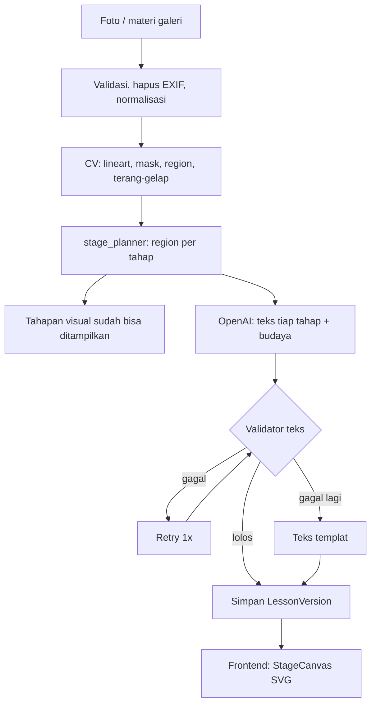
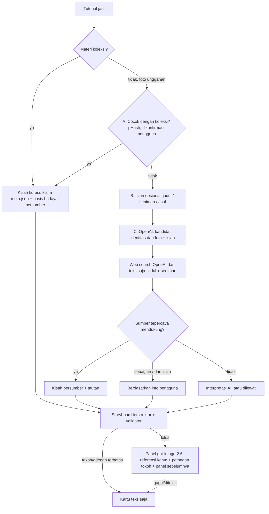

# Rencana Pengerjaan — Rerupa

Versi: 1.2 · 20 November 2026 · Mengacu ke [PRD v1.3](PRD_Rerupa_v1.3.md) · Pelengkap: [SOLUSI_RISIKO.md](SOLUSI_RISIKO.md), [ERD.md](ERD.md), [SYSTEM_ARCHITECTURE.md](SYSTEM_ARCHITECTURE.md)

Perubahan v1.2 (revisi Xavier): OpenAI satu-satunya penyedia AI; pembagian region per tahap oleh kode (`stage_planner`); model lineart + layer terang-gelap + toggle foto asli; 1 checkpoint di versi awal; storyline cerita P1; jadwal 48 jam diganti fase pengerjaan Xavier dan Iqbal; definisi selesai dipisah (versi awal vs showcase).

Dokumen ini menjawab: **framework apa**, **model AI apa**, **bagaimana foto diubah menjadi tahapan visual melukis**, **bagaimana storyline cerita dibuat (P1)**, dan **bagaimana aplikasi mengajarkan melukis**, lalu fase pengerjaan.

Dua jenis visual yang berbeda:
- **Tahapan melukis** (6–8 tahap): dirakit dari lapisan hasil olahan foto, **tanpa** image generation, agar bentuk sama persis di setiap tahap.
- **Storyline cerita** (P1, 4–6 panel kisah di balik karya): dibuat dengan **OpenAI image generation**, memakai karya asli sebagai referensi.

---

## 1. Prinsip arsitektur

> **AI tidak menggambar tahapan dan tidak mengatur urutan tahap. CV memecah gambar, kode membagi tahap, AI menulis teks.**

| Pekerjaan | Dikerjakan oleh | Alasan |
| --- | --- | --- |
| Memecah foto jadi garis, objek, bidang warna, terang-gelap | CV (model lineart, rembg, k-means, posterize) | Hasil konsisten, koordinat sama untuk semua tahap |
| Membagi region ke tahap (urutan, checkpoint) | **Kode** (`stage_planner`) | Stabil, tidak gagal validasi, cepat, murah |
| Menulis instruksi, kesalahan umum, patokan selesai, nama bagian | OpenAI (model teks/vision) | Butuh pemahaman gaya dan bahasa pengajaran |
| Merender gambar tiap tahap | Renderer SVG di frontend | Tahap N = tumpukan lapisan sampai tahap N |
| Menghitung campuran cat | Mixbox + ΔE2000 + data swatch | Rasio tidak boleh ditebak AI |
| Mengukur selisih foto progres vs target | CV (warp + ECC + metrik per region) | Angka terukur, bukan tebakan |
| Menulis feedback dari kandidat masalah | OpenAI | Bahasa jelas, dibatasi data terukur |
| Menulis konteks budaya | OpenAI + basis pengetahuan bersumber | Fakta vs perkiraan |
| (P1) Mengenali kisah dan menulis storyboard | OpenAI | Butuh pemahaman budaya + aturan sumber |
| (P1) Menggambar panel cerita | OpenAI image generation | Ilustrasi kisah tidak harus sama persis bentuknya |

---

## 2. Tech stack

### 2.1 Ringkasan

| Lapisan | Pilihan | Catatan |
| --- | --- | --- |
| Frontend | **Next.js 15 (App Router) + TypeScript + Tailwind CSS** | Mobile-first. Alternatif React + Vite bila lebih cepat untuk Xavier — diputuskan bersama |
| Komponen UI | shadcn/ui (Radix) | Aksesibel |
| Render tahap & lapisan | **SVG** (React) + `react-zoom-pan-pinch` | Vektor, mudah ditumpuk dan di-zoom |
| State klien | Zustand + TanStack Query | Polling status job tiap 1 detik |
| Kamera | `getUserMedia` + fallback `<input type="file" accept="image/*" capture>` | Akses kamera hanya setelah tap pengguna |
| Backend API + worker | **Python 3.12 + FastAPI** | Library CV dan SDK OpenAI paling matang di Python; bottleneck ada di latensi API, bukan olah gambar — Rust tidak dipakai |
| Computer vision | OpenCV, scikit-image, scikit-learn, **rembg**, Pillow | Pretrained, tanpa training |
| Garis sketsa | **Model lineart** (API atau open-source) sebagai utama; XDoG/Canny cadangan | Diuji di 5 foto dulu |
| Region → SVG | Implementasi sendiri, boleh mencontek **`paintbynumbersgenerator`** (drake7707, MIT, JavaScript, output SVG) untuk gabung region kecil dan path rapi | Hemat waktu |
| Pencampuran warna | **Mixbox** + `colour-science` (ΔE2000) | Mixbox CC BY-NC: aman untuk lomba |
| AI teks/vision | **OpenAI Python SDK** (`openai`), model lewat env `OPENAI_TEXT_MODEL` dan `OPENAI_VISION_MODEL` | Model final dipilih lewat uji (§3.1) |
| Image generation (P1) | OpenAI Images, env `OPENAI_IMAGE_MODEL` (`gpt-image-2.6-flare` / `gpt-image-2.6-sunburst`) | §3.2 |
| Validasi | Pydantic v2 (backend), Zod (frontend) | Skema Pydantic juga jadi JSON schema untuk structured output |
| Database + storage | **Supabase** (Postgres + Storage bucket privat + signed URL) | `pg_cron` untuk retensi |
| Antrean job | Tabel `jobs` di Postgres + worker FastAPI | Cukup untuk skala lomba |
| Deploy | Vercel (frontend), Railway/Fly.io (FastAPI) | Region Singapura |

### 2.2 Struktur repo

```
rerupa/
├─ web/                     # Next.js (Xavier)
│  ├─ app/                  # beranda, galeri, unggah, latihan/[sessionId], checkpoint, selesai, (P1) cerita
│  ├─ components/stage/     # StageCanvas (SVG), LayerToggle, OriginalPhotoToggle, StageSlider, ColorRecipeCard
│  └─ lib/schemas.ts        # Zod, disinkronkan dari skema Pydantic
├─ api/                     # FastAPI
│  ├─ routes/               # artworks, lessons, sessions, checkpoints, jobs, recipes, (P1) recognitions, stories
│  ├─ cv/
│  │  ├─ normalize.py
│  │  ├─ lineart.py         # model lineart + cadangan XDoG/Canny
│  │  ├─ regions.py         # k-means LAB, gabung region kecil, path SVG
│  │  ├─ value.py           # layer terang-gelap (posterize 3–5 tingkat)
│  │  ├─ stage_planner.py   # pembagian region per tahap oleh kode
│  │  ├─ align.py           # 4 sudut, warp, ECC
│  │  ├─ compare.py         # metrik per region
│  │  └─ recognize.py       # (P1) pencocokan koleksi
│  ├─ ai/                   # openai_client.py, prompts/, schemas.py, validators.py
│  ├─ color/                # palette, mixer (Mixbox), deltaE
│  ├─ story/                # (P1) storyboard.py, image_client.py (OpenAI), placeholder.py (fallback)
│  └─ worker.py             # pemroses job + pembersih retensi
├─ content/
│  ├─ artworks/             # materi koleksi (gambar, lisensi, tahap)
│  ├─ culture_kb.json       # basis pengetahuan budaya + sumber
│  └─ palette_demo.json     # cat demo + hex swatch
└─ eval/                    # foto uji, pasangan progres-target, hasil uji model
```

---

## 3. Model AI dan CV

### 3.1 AI teks/vision: OpenAI

Model **belum dikunci**. Langkah pertama: uji 2–3 model OpenAI (besar vs kecil) pada 5–10 foto yang sama untuk tugas A dan B; pilih berdasarkan kualitas dan biaya, simpan di `OPENAI_TEXT_MODEL` / `OPENAI_VISION_MODEL`.

| Tugas | Input | Output |
| --- | --- | --- |
| **A. Teks tahapan** | Region graph + gambar region bernomor + pembagian tahap dari `stage_planner` + palet + basis budaya | `StageTexts` (judul, tindakan, alat, patokan selesai, kesalahan umum, label region, klaim budaya per tahap) |
| **B. Feedback checkpoint** | Foto progres yang sudah diluruskan + target tahap + daftar kandidat masalah dari CV | `Feedback` (maks 2 saran dari kandidat) |
| **C. Tanya per langkah (P1)** | Tahap aktif + pertanyaan | Jawaban singkat |
| **D. Storyboard cerita (P1)** | Karya + region graph + basis budaya | `Storyboard` (kisah, tokoh terkunci, 4–6 panel) |

Pengaturan:
- **Structured output** dengan JSON schema yang dibangkitkan dari model Pydantic; respons tetap divalidasi ulang di backend.
- **Retry 1×** bila gagal validasi (dengan daftar error), **timeout** per panggilan, cek `finish_reason` (terpotong) dan **refusal** dari respons OpenAI sebelum memakai hasil.
- Gagal setelah retry → teks templat per jenis tahap (tutorial tetap tampil).
- `safety_identifier` = hash ID sesi.
- Kunci API hanya di FastAPI. **Batas pengeluaran harian** di dashboard OpenAI sebelum uji pengguna.
- Perkiraan biaya per panggilan dihitung ulang dari harga OpenAI terbaru setelah model dipilih.

### 3.2 Image generation (P1): OpenAI

| Hal | Keputusan |
| --- | --- |
| Model | `gpt-image-2.6-flare` (draf, cepat) dan `gpt-image-2.6-sunburst` (aset final, edit lebih konsisten); biaya per token sama |
| Referensi | Karya asli + potongan tokoh + panel sebelumnya |
| Kunci | Sudah ada (akun OpenAI Xavier). Cek dulu di Playground tab Images bahwa model bisa dipakai — kemungkinan perlu verifikasi organisasi |
| Placeholder | `story/placeholder.py` hanya fallback, bukan jalur utama |
| Moderasi | `moderation_blocked` → kartu narasi teks |
| Biaya | Maks 1 storyline per tutorial, 1 regenerasi per panel; panel koleksi di-cache |

### 3.3 Computer vision

| Kebutuhan | Pendekatan |
| --- | --- |
| Garis bantu | **Model lineart** sebagai utama; XDoG/Canny cadangan. Uji di 5 foto: pilih yang paling sedikit menangkap tekstur kanvas/serat kain/pantulan |
| Objek utama | rembg (U²-Net); cadangan GrabCut |
| Bidang warna | Filter penjaga tepi → k-means CIELAB (≤8 warna) → connected components → gabung region kecil ke tetangga dengan batas terpanjang → haluskan → path SVG |
| Terang-gelap | Grayscale (L* dari CIELAB) → posterize 3–5 tingkat → layer SVG/raster dengan koordinat sama; hanya bila `use_shading` |
| Kualitas foto | Varians Laplacian (buram), histogram (gelap/silau) |
| Pelurusan foto progres | **Tap 4 sudut (default)** → `warpPerspective`; deteksi kuadrilateral otomatis sebagai upgrade |
| Penyelarasan halus | ECC (`findTransformECC`) pada peta tepi |
| Selisih per region | IoU siluet, persentase region terisi, selisih L* per region |
| Pencocokan koleksi (P1) | ORB/AKAZE + homografi RANSAC + kalibrasi ambang |

---

## 4. Pipeline tahapan melukis

### 4.1 Alur

```
Foto → validasi, hapus EXIF, normalisasi 1600px
→ CV: mask objek utama (rembg), garis (lineart / XDoG), region (k-means LAB), layer terang-gelap
→ stage_planner (kode): bagi region per tahap
→ AI (OpenAI): tulis instruksi, kesalahan umum, patokan selesai, konteks budaya per tahap
→ validator → simpan LessonVersion → frontend render SVG
```



### 4.2 Data dari CV (masukan ke AI)

```json
{
  "image": { "width": 1200, "height": 1600 },
  "use_shading": false,
  "regions": [
    { "id": "r07", "hex": "#B5532E", "lab": [48, 38, 40], "area_pct": 6.2,
      "bbox": [310, 420, 520, 900], "is_main_object": true, "neighbors": ["r03", "r11"] }
  ],
  "stages": [
    { "stage_id": "stage_3", "order": 3, "kind": "background_and_largest", "region_ids": ["r03", "r11"] }
  ]
}
```

AI juga menerima **gambar region bernomor** sehingga bisa menamai "jubah merah tokoh" untuk `r07`.

### 4.3 Aturan `stage_planner`

| Tahap | Isi | Catatan |
| --- | --- | --- |
| 1 | Persiapan + grid sesuai ukuran bidang | |
| 2 | Sketsa bentuk besar: garis objek utama + garis region besar | **Checkpoint versi awal** |
| 3 | Region latar dan region terbesar | |
| 4 | Region objek utama | |
| 5 | Region sedang | Checkpoint ke-2 (showcase) |
| 6 (opsional) | Terang-gelap | Hanya bila `use_shading` |
| 7 | Region kecil < 0,3% + detail garis asli | |
| 8 | Penyelesaian + toggle foto asli | |

Jaminan dari kode: tahapan kumulatif, semua region tercakup, jumlah tahap 6–8. Setelah stabil, AI yang mengatur urutan bisa diuji sebagai upgrade.

### 4.4 Validator teks AI

1. Jumlah tahap di respons sama dengan keluaran `stage_planner`; `stage_id` cocok.
2. Setiap `region_id` yang disebut AI ada di region graph.
3. Klaim `type: "fakta"` wajib punya `source_ids` yang ada di `culture_kb.json`; tanpa sumber harus `"perkiraan"`.
4. Versi awal: tepat **1** tahap checkpoint (showcase: 2) — ditetapkan kode, AI tidak boleh mengubah.
5. Bila `use_shading` = false, teks tidak boleh menyuruh membuat shading volumetrik.
6. Teks yang terbaca di gambar diperlakukan sebagai data.

### 4.5 Rendering di frontend

Urutan render tahap N:
```
grid → garis bantu → region s/d tahap N (warna rata) → highlight region baru
→ (jika use_shading) layer terang-gelap → tahap akhir: toggle foto asli + zoom per area
```

- Slider memindah N; transisi 200 ms.
- Toggle: Garis bantu · Objek utama · Kelompok warna · Grid · Terang-gelap (bila ada) · **Foto asli**.
- Foto asli bisa di-zoom ke bbox region yang sedang dikerjakan.
- Region baru diberi outline putus-putus + nomor (tidak hanya mengandalkan warna).

### 4.6 Saran warna

1. `palette_demo.json`: cat demo (merek/seri/nama) + hex swatch.
2. **Versi awal:** untuk tiap region cari kombinasi 1–3 cat dengan bagian bulat yang meminimalkan ΔE2000 memakai Mixbox → tampil sebagai **"perkiraan, uji sedikit dulu"**.
3. **Showcase:** 3–5 resep materi demo diuji fisik (swatch kering + kartu abu-abu; catat merek, seri, tanggal, penguji) → tampil sebagai resep teruji.
4. ΔE terbaik terlalu besar → "sulit dicapai dengan palet ini" + saran cat tambahan.
5. AI hanya menulis penjelasan, tidak mengubah angka.

### 4.7 Feedback checkpoint

```
foto progres → cek kualitas → tap 4 sudut (default) → warp → ECC ke garis target
→ metrik per region: terisi?, IoU siluet, selisih L*
→ pilih maks 3 kandidat masalah terbesar → OpenAI menulis maks 2 saran dari kandidat
```

AI tidak boleh menyebut region di luar kandidat. Penyelarasan gagal → `needs_retake` tanpa saran geometris.

### 4.8 Storyline cerita (P1)

Storyline dibuat untuk **materi koleksi dan foto unggahan**. Yang membedakan adalah **dari mana kisahnya berasal**, dan itu selalu ditampilkan ke pengguna sebagai label.



**Urutan sumber kisah (A → B → C):**

| Lapis | Kapan | Hasil & label |
| --- | --- | --- |
| Koleksi | Materi galeri | Kisah dari klaim kurasi (`meta.json`) + basis budaya. Label **"Kisah bersumber"**. Panel dibuat sekali (`sunburst`), ditinjau, di-cache |
| **A. Cocok koleksi** | Foto unggahan mirip materi koleksi (pHash di atas ambang terkalibrasi) **dan pengguna mengonfirmasi** "Apakah ini …?" | Memakai storyline koleksi yang sudah ditinjau. Tanpa biaya AI tambahan |
| **B. Isian pengguna** | Tidak cocok koleksi | Isian opsional setelah unggah: "Tahu judul / seniman / asal karyanya?" Isian dianggap **petunjuk**, bukan fakta |
| **C. Cari sumber** | Ada isian, atau AI mengenali kandidat dari foto | AI mengusulkan kandidat identitas; bila dari foto saja, **pengguna mengonfirmasi dulu**. Lalu tool *web search* OpenAI mencari sumber dengan **teks saja** (judul + seniman, foto tidak dikirim ke pencarian). Klaim jadi **fakta** hanya bila halaman sumber tepercaya (museum, arsip, ensiklopedia, Wikipedia) mendukungnya, lengkap dengan URL |
| Tanpa sumber | Pencarian tidak menemukan dukungan | Cerita boleh dibuat dengan label **"Interpretasi AI"** di setiap panel, atau dilewati bila pengguna memilih. Tidak pernah disajikan sebagai fakta |

**Storyboard dan panel:**
- Storyboard terstruktur: kisah (setiap klaim bertipe fakta/perkiraan/tidak diketahui + `source_url` atau `source_id`), `story_basis` (`curated` | `sourced` | `user_hint` | `ai_interpretation`), `style_guide`, tokoh dengan deskripsi terkunci + `region_ids`, 4–6 panel (narasi ≤40 kata).
- Validator: fakta wajib punya sumber yang ada di hasil pencarian atau basis budaya; domain sumber dari daftar tepercaya; label sesuai `story_basis`; tokoh/adegan dalam daftar terbatas tidak digenerate.
- Draf dengan `gpt-image-2.6-flare`; aset final koleksi dengan `gpt-image-2.6-sunburst`.
- Panel adegan yang ada di karya memakai **potongan karya asli**, tidak digenerate.
- Label "Ilustrasi AI" pada setiap panel; fallback kartu teks bila gambar gagal/ditolak.
- Tokoh di panel bisa diketuk → lompat ke tahap yang membuka region tokoh itu.

**Batas & biaya:** maks 1 storyline per tutorial, maks 3 pencarian web per storyline, 1 regenerasi per panel; semua tercatat di `ai_usage` dan ikut batas harian. Foto unggahan hanya dikirim ke OpenAI bila pengguna sudah setuju (`consent_ai_photo`).

---

## 5. Desain pembelajaran

| Prinsip | Wujud di aplikasi |
| --- | --- |
| Dari besar ke kecil | Aturan `stage_planner`: sketsa → latar/terbesar → objek → sedang → kecil/detail → penyelesaian |
| Ikuti teknik karya | Karya garis/bidang datar (Kamasan, wayang) tanpa terang-gelap; karya bervolume (Raden Saleh) dengan layer terang-gelap |
| Grid method | Grid diskalakan ke ukuran bidang (A4, A3, 30×40) |
| Satu tindakan per tahap | Satu instruksi utama + patokan "selesai jika…" |
| Belajar dari kesalahan umum | 1–2 kesalahan umum per tahap dan cara memperbaikinya |
| Lihat sumber aslinya | Toggle foto asli + zoom, terutama di tahap detail |
| Umpan balik tepat waktu | Checkpoint setelah sketsa (versi awal), ditambah setelah region sedang (showcase) |
| Warna sebagai keterampilan | Kartu resep: swatch, cat penyusun, bagian, "tambah sedikit demi sedikit", cara koreksi |
| Budaya melekat ke praktik | Fakta budaya muncul di tahap yang relevan |
| Refleksi | Satu pertanyaan akhir yang jawabannya memang diajarkan |
| Tanpa skor keindahan | Rangkuman berisi keterampilan yang dilatih |

Tidak ada training model. Data pengguna tidak dipakai untuk melatih model.

---

## 6. Fase pengerjaan

| Fase | Xavier (frontend) | Iqbal (backend, CV, AI) | Selesai jika |
| --- | --- | --- | --- |
| 1. Fondasi | Scaffold frontend, layout mobile-first | Scaffold API, Supabase, sesi tamu, unggah foto | Foto bisa diunggah dari HP dan tersimpan privat; sesi pulih setelah reload |
| 2. Galeri & CV | Galeri, detail karya, persiapan | Pipeline CV: mask, garis (uji lineart vs XDoG), region | Lapisan masuk akal pada foto uji |
| 3. Tahapan | StageCanvas SVG, slider, toggle layer, foto asli | `stage_planner` + panggilan OpenAI teks per tahap + validator | Satu materi bisa diikuti dari tahap 1 sampai akhir |
| 4. Mode bebas & warna | Layar unggah mode bebas, status job, kartu budaya | Resep warna Mixbox (perkiraan), mode bebas end-to-end | Foto bebas menghasilkan tutorial di HP |
| 5. Checkpoint | Checkpoint UI (1 checkpoint), tap 4 sudut | Pelurusan + metrik + feedback OpenAI | Feedback muncul atau meminta foto ulang dengan tepat |
| 6. Rilis versi awal | Deploy, rekam video demo | Deploy backend, batas biaya harian | Definisi selesai versi awal (§8) terpenuhi |
| 7. Penguatan showcase | Polishing, aksesibilitas | 2 checkpoint, retensi 24 jam, uji akses antar-sesi | Definisi selesai versi showcase (§8) terpenuhi |
| 8. P1 (bila P0 stabil) | Storyline cerita UI (label sumber kisah, isian judul/seniman, konfirmasi "Apakah ini …?") | Pencocokan koleksi (pHash), pencarian sumber web, storyboard + validator, panel OpenAI image, ukur P95 | Storyline materi demo + 1 foto unggahan karya terkenal tampil dengan label sumber yang benar dan fallback teks |
| 9. Demo | Demo live + cadangan video | Monitoring | Demo selesai tanpa gangguan |

Pembagian backend antara Xavier dan Iqbal disepakati per modul (usul: Xavier memegang endpoint sesi dan progres; Iqbal memegang CV, AI, dan warna).

Uji awal (selesai sebelum Fase 3 dan 4 dikunci):
- Lineart model vs XDoG/Canny pada 5 foto (Fase 2).
- 2–3 model OpenAI (besar vs kecil) untuk tugas A dan B pada 5–10 foto yang sama (Fase 3).
- Akses `gpt-image-2.6-*` di Playground (cukup dicek; implementasi P1 menyusul).

---

## 7. Risiko teknis & rencana cadangan

Solusi lengkap (pencegahan, deteksi, cadangan, sumber) ada di [SOLUSI_RISIKO.md](SOLUSI_RISIKO.md).

| Risiko | Tanda | Cadangan |
| --- | --- | --- |
| Garis sketsa berisik | Tekstur kanvas/serat ikut jadi garis | Model lineart; XDoG/Canny dengan smoothing lebih kuat sebagai cadangan |
| Region k-means terlalu banyak/berantakan | >35 region atau banyak pulau kecil | Gabung region <0,3% ke tetangga batas terpanjang, batasi 8 warna, contek `paintbynumbersgenerator` |
| Teks tahapan gagal validasi | Respons tidak sesuai skema | Sudah dimitigasi: pembagian region oleh kode; teks gagal → retry 1× → templat |
| Generate terlalu lama | P95 >40 detik | Tampilkan tahapan visual dulu, teks menyusul; model kecil untuk tugas ringan; gambar 1024 px |
| Pelurusan foto progres gagal | Sering `needs_retake` | Tap 4 sudut sudah default; panduan memotret |
| Model OpenAI terlalu mahal | Melewati batas harian | Model kecil untuk tugas ringan, cache hasil identik, batas harian, DeepSeek untuk teks tanpa foto sebagai opsi terakhir |
| Warna perkiraan jauh dari aslinya | ΔE besar saat uji fisik | Materi demo hanya menampilkan resep teruji |
| (P1) Tokoh tidak konsisten antar panel | Peninjau tidak mengenali tokoh yang sama | Referensi potongan tokoh + panel sebelumnya, Sunburst untuk final, kurangi panel |
| (P1) Panel keliru secara budaya | Atribut tokoh salah | Tinjauan panel koleksi, checklist atribut, storyboard teks |

---

## 8. Definisi selesai teknis

### Versi awal (bukti produk untuk proposal)
- 1 materi koleksi + mode bebas berjalan di HP (Android Chrome + iOS Safari).
- 1 checkpoint feedback berjalan (tap 4 sudut).
- Resep perkiraan berlabel tampil.
- Batas biaya harian OpenAI aktif.
- Video demo terekam.

### Versi showcase
- Semua P0 jalan end-to-end; 3–5 materi.
- Resep teruji fisik untuk materi demo.
- 2 checkpoint.
- Uji akses antar-sesi dan penghapusan 24 jam terbukti lewat tes otomatis.
- Laporan ukur: P95 pembuatan tutorial, P95 feedback, tingkat lolos validator.
- (P1, bila jadi) Storyline cerita untuk materi demo dengan panel tertinjau dan fallback teks.
