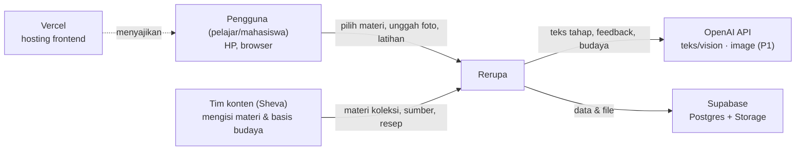
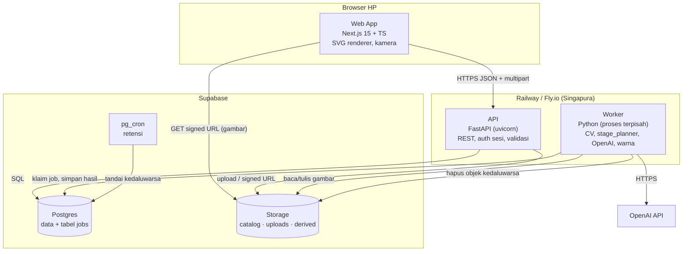
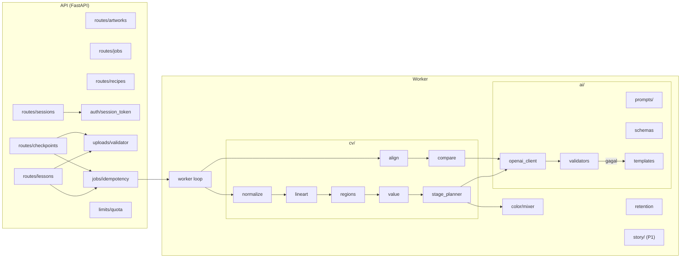
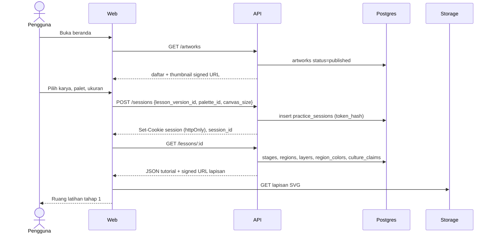
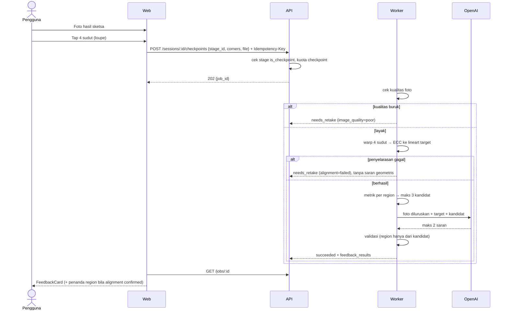
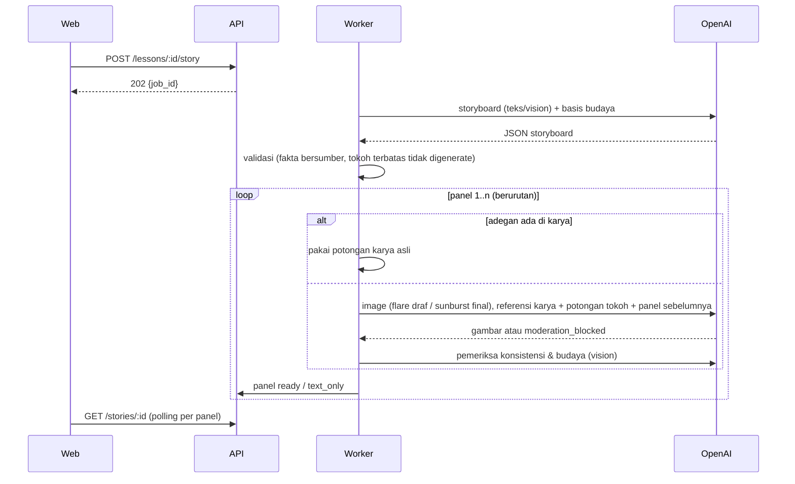
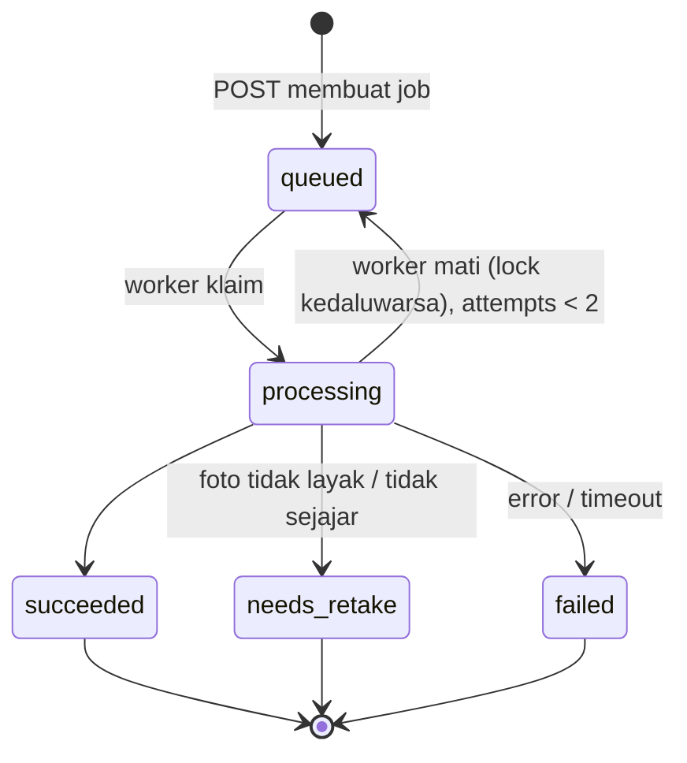
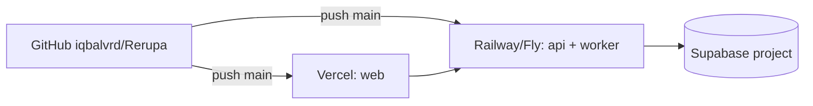

# System Architecture — Rerupa

Versi: 1.0 · 20 November 2026 · Mengacu ke [PRD v1.3](PRD_Rerupa_v1.3.md), [Rencana v1.2](RENCANA_PENGERJAAN.md), [ERD.md](ERD.md)

---

## 1. Ringkasan

Rerupa adalah web app mobile-first dengan tiga bagian utama:

1. **Web (Next.js)** — UI galeri, unggah, ruang latihan SVG, checkpoint.
2. **API + Worker (FastAPI, Python)** — sesi, validasi file, pipeline CV, `stage_planner`, pencampuran warna, integrasi OpenAI, antrean job.
3. **Supabase** — Postgres (data) + Storage (gambar) + `pg_cron` (retensi).

Penyedia AI tunggal: **OpenAI** (teks/vision; P1: image generation).

Prinsip:
- **CV memecah gambar, kode membagi tahap, AI menulis teks.** AI tidak menggambar tahapan dan tidak mengubah angka resep.
- **Frontend tidak pernah bicara langsung ke database, Storage, atau OpenAI.** Semua lewat API.
- **Pekerjaan berat berjalan di worker**, API hanya membuat job dan melaporkan status.
- **Gagal dengan anggun:** tahapan visual tetap tampil walau AI gagal; teks diganti templat.

---

## 2. Konteks sistem (C4 level 1)



| Aktor/sistem | Peran | Data yang diterima |
| --- | --- | --- |
| Pengguna | Memakai aplikasi tanpa akun | Tutorial, resep, feedback |
| Tim konten | Mengelola katalog (lewat skrip impor/SQL; dashboard admin di luar MVP) | — |
| OpenAI | Menulis teks tahap, konteks budaya, feedback; (P1) storyboard + panel | Gambar ternormalisasi/diluruskan, region graph, teks basis budaya. **Satu-satunya pihak luar yang menerima foto pengguna** |
| Supabase | Penyimpanan | Semua data aplikasi |

---

## 3. Container (C4 level 2)



| Container | Teknologi | Tanggung jawab | Skala |
| --- | --- | --- | --- |
| Web | Next.js 15 (App Router), TypeScript, Tailwind, shadcn/ui, Zustand, TanStack Query, react-zoom-pan-pinch | UI, kamera, tap 4 sudut, render SVG tahap, polling job | Static/edge di Vercel |
| API | FastAPI, Pydantic v2, `supabase-py`/`asyncpg` | Endpoint REST, sesi tamu, validasi file, idempotensi, kuota, signed URL | 1 instance (cukup untuk lomba) |
| Worker | Python 3.12, OpenCV, scikit-image, scikit-learn, rembg, Mixbox, colour-science, `openai` | Semua pekerjaan berat + panggilan AI + retensi file | 1 instance, 2–4 job paralel |
| Postgres | Supabase | Data + antrean job | Free/Pro tier |
| Storage | Supabase Storage | Gambar | 3 bucket privat |
| pg_cron | Supabase | Jadwal retensi | tiap 15 menit |

API dan Worker berbagi satu codebase (`api/`) dengan dua entrypoint: `uvicorn api.main:app` dan `python -m api.worker`.

---

## 4. Komponen backend (C4 level 3)



| Modul | Fungsi utama | Masukan → Keluaran |
| --- | --- | --- |
| `auth/session_token` | Buat token acak 256-bit, set cookie httpOnly, verifikasi `token_hash` | cookie → `session_id` |
| `uploads/validator` | Cek magic bytes, ukuran ≤10 MB, ≤25 MP, decode aman, hapus EXIF | file → `uploads` row |
| `jobs/idempotency` | Kunci `(session, type, Idempotency-Key)` + `payload_hash` | request → job baru / job lama / 409 |
| `limits/quota` | Kuota per sesi + batas biaya harian dari `ai_usage` | sesi → izinkan / 429 |
| `cv/normalize` | Orientasi, crop cakupan, resize sisi panjang 1600 px, versi 1024 px untuk AI | foto → gambar ternormalisasi |
| `cv/lineart` | Model lineart; cadangan XDoG/Canny + buang segmen pendek | gambar → layer `lineart` (SVG) |
| `cv/regions` | Filter penjaga tepi → k-means CIELAB ≤8 warna → komponen → gabung region kecil → path SVG | gambar → `regions` + layer `regions` |
| `cv/value` | L* → posterize 3–5 tingkat (hanya `use_shading`) | gambar → layer `value` |
| `cv/stage_planner` | Bagi region ke 6–8 tahap sesuai aturan PRD §8; tetapkan checkpoint | regions → `stages` + `stage_regions` |
| `color/mixer` | Mixbox + ΔE2000: kombinasi 1–3 cat, bagian bulat | region hex + palet → `region_colors` |
| `ai/openai_client` | Panggilan OpenAI dengan structured output, timeout, retry 1×, cek `finish_reason`/refusal, `safety_identifier`, catat `ai_usage` | prompt + gambar → JSON tervalidasi |
| `ai/validators` | Aturan PRD: region_id ada, fakta bersumber, jumlah tahap cocok, larangan shading | JSON → lolos / daftar error |
| `ai/templates` | Teks cadangan per `stage_kind` | stage_kind → teks |
| `cv/align` | Warp dari 4 sudut tap → ECC pada peta tepi | foto progres → foto diluruskan + status |
| `cv/compare` | IoU siluet, % terisi, selisih L* per region → kandidat masalah (maks 3) | foto diluruskan + target → kandidat |
| `retention` | Hapus objek Storage kedaluwarsa, bersihkan sesi terhapus | — |
| `story/` (P1) | Storyboard (OpenAI teks) → panel (OpenAI image) → pemeriksa | lesson → `stories`, `story_panels` |

---

## 5. Komponen frontend

| Rute | Layar (PRD §12) | Komponen kunci |
| --- | --- | --- |
| `/` | Beranda | `CollectionGrid`, `FreeModeCTA` |
| `/karya/[slug]` | Detail karya | `CultureCard` (label Fakta/Perkiraan + sumber), `LicenseBadge` |
| `/unggah` | Unggah mode bebas | `CameraCapture`, `FilePicker`, `QualityHint`, `ConsentNotice` |
| `/proses/[jobId]` | Membuat tutorial | `JobStatus` (menganalisis → membagi tahap → menulis instruksi) |
| `/persiapan/[sessionId]` | Persiapan | `PaletteSelect`, `CanvasSizeSelect`, `ScopeCrop` |
| `/latihan/[sessionId]` | Ruang latihan | `StageCanvas`, `LayerToggle`, `OriginalPhotoToggle`, `StageSlider`, `StageInstruction`, `ColorRecipeCard` |
| `/checkpoint/[sessionId]` | Checkpoint | `CaptureGuide`, `CornerTapper` (loupe), `FeedbackCard` |
| `/selesai/[sessionId]` | Selesai | `SkillSummary`, `ReflectionQuestion`, `DeleteSessionButton` |
| `/cerita/[lessonId]` (P1) | Cerita | `StoryCarousel`, `PanelLabel`, `CharacterLink` |

### 5.1 `StageCanvas`

Semua lapisan berada dalam satu `<svg viewBox="0 0 W H">` dengan W×H = `lesson_versions.image_width/height`, sehingga koordinat selalu sama.

```
<svg>
  <g id="grid"/>                  // dari visual_layers.grid
  <g id="lineart"/>               // garis bantu
  <g id="regions">                // region dengan order tahap ≤ N, warna rata
    <path class="new-in-stage"/>  // outline putus-putus + nomor
  </g>
  <g id="value"/>                 // bila use_shading dan toggle aktif
  <g id="detail-lines"/>          // tahap detail
  <image id="original"/>          // toggle Foto asli, zoom ke stages.focus_bbox
</svg>
```

- Region untuk tahap N = semua `stage_regions` dengan `stages.order_no ≤ N` (dihitung di klien dari data yang sudah dimuat → navigasi ≤300 ms tanpa request baru).
- Zoom/pan dengan `react-zoom-pan-pinch`; tombol "Zoom ke area ini" memakai `focus_bbox`.
- Aksesibilitas: setiap toggle punya label; region baru juga diumumkan sebagai teks ("Tahap 4: isi jubah merah tokoh utama").

### 5.2 State klien

| State | Tempat | Catatan |
| --- | --- | --- |
| Data tutorial (lesson, regions, stages, layers) | TanStack Query cache | Dimuat sekali per sesi |
| Tahap aktif, toggle lapisan | Zustand + `localStorage` (try/catch) | Kenyamanan, bukan sumber kebenaran |
| Progres tahap | Server (`PATCH /sessions/:id/progress`) | Sumber kebenaran |
| Status job | Polling `GET /jobs/:id` tiap 1 detik, berhenti di status final | |

---

## 6. Alur utama (sequence)

### 6.1 Mulai dari galeri (materi koleksi)



### 6.2 Mode bebas: unggah foto → tutorial otomatis

```mermaid
sequenceDiagram
    actor U as Pengguna
    participant W as Web
    participant A as API
    participant DB as Postgres
    participant S as Storage
    participant K as Worker
    participant O as OpenAI

    U->>W: Ambil/unggah foto + setujui pengiriman ke AI
    W->>A: POST /lessons/generate (multipart, Idempotency-Key)
    A->>A: validasi file, hapus EXIF, cek kuota
    A->>S: simpan uploads/raw
    A->>DB: insert uploads, jobs(queued)
    A-->>W: 202 {job_id}
    loop tiap 1 detik
        W->>A: GET /jobs/:id
        A-->>W: status + progress.step
    end
    K->>DB: klaim job (FOR UPDATE SKIP LOCKED)
    K->>S: baca foto
    K->>K: normalize → lineart → regions → value
    K->>K: stage_planner → color/mixer
    K->>DB: simpan lesson_version (session_private), regions, stages, layers
    Note over W,K: progress.step = planning → tahapan visual sudah bisa ditampilkan
    K->>O: teks tahap + budaya (gambar 1024 px + region graph + KB)
    O-->>K: JSON
    K->>K: validasi; gagal → retry 1× → templat
    K->>DB: update stages, culture_claims, ai_usage; job succeeded
    W->>A: GET /lessons/:id
    W-->>U: Ruang latihan
```

### 6.3 Checkpoint feedback



### 6.4 Hapus sesi dan retensi

```mermaid
sequenceDiagram
    actor U as Pengguna
    participant W as Web
    participant A as API
    participant DB as Postgres
    participant C as pg_cron
    participant K as Worker
    participant S as Storage

    U->>W: Hapus sesi
    W->>A: DELETE /sessions/:id
    A->>DB: set deleted_at = now()
    A-->>W: 204 + hapus cookie
    Note over A,DB: Semua request dengan token ini langsung ditolak
    C->>DB: tiap 15 menit: tandai uploads kedaluwarsa & sesi terhapus
    K->>S: hapus objek uploads/derived
    K->>DB: purged_at; hapus sesi (CASCADE) ≤24 jam
```

### 6.5 (P1) Storyline cerita



---

## 7. Antrean job

### 7.1 State machine



### 7.2 Mekanisme

- **Klaim:** `UPDATE jobs SET status='processing', locked_by=$w, locked_at=now() WHERE id = (SELECT id FROM jobs WHERE status='queued' ORDER BY created_at FOR UPDATE SKIP LOCKED LIMIT 1) RETURNING *`.
- **Polling worker:** tiap 500 ms bila kosong; konkurensi 2–4 job (CV memakan CPU).
- **Lock kedaluwarsa:** job `processing` dengan `locked_at` > 2 menit dikembalikan ke `queued` (maks 2 percobaan), lalu `failed`.
- **Timeout:** `generate_lesson` 60 detik, `feedback` 45 detik (PRD §16).
- **Idempotensi:** kunci sama + payload sama → kembalikan job lama; payload beda → `409 idempotency_conflict`. Retry dari klien tidak menggandakan biaya.
- **Progress:** `jobs.progress.step` = `validating` → `cv` → `planning` → `writing` → `done`, dipakai layar "Membuat tutorial".

### 7.3 Kode error (dipetakan ke pesan pengguna)

| Kode | Arti | Pesan UI (ringkas) |
| --- | --- | --- |
| `file_invalid` | Bukan gambar / terlalu besar | "File tidak didukung. Pakai JPG/PNG/WebP ≤10 MB." |
| `photo_unusable` | Buram/gelap/silau | "Foto kurang jelas. Coba ambil ulang di tempat terang." |
| `not_artwork` | Bidang kosong/bukan karya | "Sepertinya bukan karya lukis. Pilih dari galeri?" |
| `too_complex` | Region terlalu banyak | "Karyanya rumit. Coba potong bagian yang lebih kecil." |
| `alignment_failed` | 4 sudut/ECC gagal | "Sudut belum pas. Tap ulang keempat sudut bidang." |
| `quota_exceeded` | Kuota sesi habis | "Batas latihan sesi ini tercapai." |
| `budget_exceeded` | Batas biaya harian | "Fitur AI sedang penuh. Coba materi dari galeri." |
| `ai_unavailable` | OpenAI timeout/error | "Instruksi otomatis belum tersedia. Tahapan tetap bisa dipakai." |
| `ai_refused` | Refusal / moderasi | "Bagian ini tidak bisa dibuat otomatis." |

---

## 8. Kontrak API

Basis: `https://api.rerupa…/v1`. Format JSON. Autentikasi sesi lewat cookie `rerupa_session` (httpOnly, Secure, SameSite=Lax). Endpoint yang mengubah data membutuhkan header `Idempotency-Key` bila membuat job.

| Metode & path | Auth | Request | Response | Catatan |
| --- | --- | --- | --- | --- |
| `GET /artworks` | — | — | `[{slug, title, artist, tradition, thumbnail_url, license, lesson_version_id}]` | Hanya `published` |
| `GET /artworks/:slug` | — | — | detail + `culture_claims` + sumber | |
| `POST /sessions` | — | `{lesson_version_id?, palette_id, canvas_size}` | `201 {session_id, expires_at}` + Set-Cookie | |
| `GET /sessions/:id` | sesi | — | pilihan, tahap aktif, progres | 404 bila bukan milik sesi |
| `PATCH /sessions/:id/progress` | sesi | `{stage_id, status}` | `200` | Melihat ≠ selesai |
| `DELETE /sessions/:id` | sesi | — | `204` | Cabut akses seketika |
| `POST /lessons/generate` | sesi | multipart `file`, `scope?`, `consent_ai_photo` | `202 {job_id}` | Idempotency-Key wajib |
| `GET /lessons/:id` | publik (koleksi) / sesi (mode bebas) | — | lesson + stages + regions + layer URLs + region_colors + claims | Signed URL ≤5 menit untuk mode bebas |
| `GET /recipes/:id` | — | `?palette_id` | resep + swatch URL | |
| `POST /sessions/:id/checkpoints` | sesi | multipart `file`, `stage_id`, `corners[8]` | `202 {job_id}` | Idempotency-Key wajib; hanya tahap checkpoint |
| `GET /jobs/:id` | sesi | — | `{status, progress, error_code?, result?}` | Hanya job milik sesi |
| `POST /events` | sesi | `{name, props}` | `202` | Props divalidasi whitelist |
| `POST /recognitions` (P1) | sesi | multipart `file` | `202 {job_id}` | |
| `POST /lessons/:id/story` (P1) | sesi | — | `202 {job_id}` | Maks 1 per tutorial |
| `GET /stories/:id` (P1) | sesi/publik | — | storyboard + status per panel | |

Contoh `GET /jobs/:id` (feedback selesai):
```json
{
  "status": "succeeded",
  "progress": { "step": "done" },
  "result": {
    "stage_id": "…",
    "image_quality": "usable",
    "alignment": "confirmed",
    "needs_retake": false,
    "suggestions": [
      { "region_code": "r07", "observation": "Sisi kiri tampak lebih lebar dari panduan.", "action": "Periksa garis bantu sebelum mengisi warna." }
    ],
    "markers": [{ "region_code": "r07", "bbox": [310, 420, 210, 480] }]
  }
}
```

---

## 9. Lapisan integrasi AI

### 9.1 Pemanggilan OpenAI

```
build_prompt(task, inputs)          # prompts/{task}.v{n}.md, awalan tetap (sistem + basis budaya) agar cache awalan berlaku
→ client.call(model=env[task], input=[teks, gambar], response_format=json_schema(Pydantic),
              safety_identifier=session.safety_id, timeout=…)
→ cek refusal / finish_reason
→ parse Pydantic → validators.check(task, result, context)
→ gagal: retry 1× dengan daftar error → gagal lagi: templat / needs_retake / text_only
→ catat ai_usage (token, biaya, latensi, outcome)
```

| Tugas | Env model | Masukan gambar | Keluaran | Cadangan |
| --- | --- | --- | --- | --- |
| `stage_text` | `OPENAI_VISION_MODEL` | Gambar 1024 px + gambar region bernomor | `StageTexts` | Templat per `stage_kind` |
| `feedback` | `OPENAI_VISION_MODEL` | Foto diluruskan + render target tahap | `Feedback` | `needs_retake` atau pesan umum |
| `culture` | `OPENAI_TEXT_MODEL` (atau digabung ke `stage_text`) | — | `CultureClaims` | Hanya klaim dari KB |
| `storyboard` (P1) | `OPENAI_VISION_MODEL` | Karya | `Storyboard` | Fitur dilewati |
| `panel` (P1) | `OPENAI_IMAGE_MODEL` | Karya + potongan tokoh + panel sebelumnya | Gambar | `text_only` |
| `panel_check` (P1) | `OPENAI_VISION_MODEL` | Panel + potongan tokoh | `PanelCheck` | Regenerasi 1× → `text_only` |

### 9.2 Pengaman (guardrails)

- Prompt sistem menyatakan: teks di gambar, nama file, metadata = **data**, bukan instruksi.
- Hanya region dari region graph / kandidat CV yang boleh disebut (divalidasi).
- Klaim `fakta` hanya bila `source_code` ada di KB yang dikirim; selain itu dipaksa `perkiraan`.
- Angka resep tidak pernah dikirim untuk diubah — AI hanya menerima resep jadi untuk dijelaskan.
- Foto yang dikirim: versi ternormalisasi/diluruskan, EXIF dihapus, ≤1024 px.
- Respons tidak pernah dirender sebagai HTML.

### 9.3 Biaya

- Batas pengeluaran harian di **dashboard OpenAI** (wajib sebelum uji pengguna) + batas aplikasi dari `SUM(ai_usage.cost_usd)` hari ini → `budget_exceeded`.
- Kuota per sesi: 3 `generate_lesson`, checkpoint sesuai `checkpoint_count`, 1 retry per checkpoint.
- Cache: `uploads.sha256` sama + parameter sama → pakai `lesson_version` yang sudah ada milik sesi yang sama.

---

## 10. Pipeline CV (detail teknis)

| Langkah | Implementasi | Parameter awal |
| --- | --- | --- |
| Decode aman | Pillow dengan `MAX_IMAGE_PIXELS = 25e6`, `ImageOps.exif_transpose` lalu buang EXIF | |
| Normalisasi | Crop `scope`, resize sisi panjang 1600 px (analisis) + 1024 px (AI) | |
| Objek utama | `rembg` (U²-Net) → mask biner → kontur terbesar | |
| Lineart | Model lineart; cadangan XDoG (σ 0,8, k 1,6, τ 0,98) / Canny + buang komponen < 20 px | Diuji 22 Nov |
| Region | `pyrMeanShiftFiltering` → k-means LAB (k ≤ 8) → connected components → gabung < luas minimum (±1 cm² pada ukuran bidang) ke tetangga batas terpanjang → morfologi → `approxPolyDP` | ≤35 region |
| Terang-gelap | L* → posterize 3–5 tingkat → kontur → SVG | Hanya `use_shading` |
| `stage_planner` | Aturan PRD §8: tahap 1 grid, 2 sketsa (checkpoint), 3 latar+terbesar, 4 objek utama, 5 sedang, 6 value (opsional), 7 kecil+detail, 8 penyelesaian | Tahap kosong digabung agar tetap 6–8 |
| Warna | Mixbox, cari 1–3 cat × bagian 1–4, ΔE2000 | ≤3 resep, 3–8 perkiraan, >8 sulit |
| Align | `getPerspectiveTransform` dari 4 sudut → `findTransformECC` (MOTION_AFFINE) pada peta tepi | ECC gagal → `alignment_failed` |
| Compare | Per region target: % piksel terisi, IoU siluet, ΔL* rata-rata → skor masalah → 3 teratas | |

Semua layer disimpan dalam ruang koordinat gambar ternormalisasi (`image_width × image_height`).

---

## 11. Keamanan

| Area | Kontrol |
| --- | --- |
| Sesi tamu | Token acak 256-bit di cookie httpOnly/Secure/SameSite=Lax; DB hanya menyimpan SHA-256; kedaluwarsa 7 hari; `deleted_at` mencabut seketika |
| Otorisasi | Setiap query sesi difilter `session_id` dari token; ID di URL hanya pencarian, bukan bukti akses → akses sesi lain = 404 |
| Database | RLS aktif tanpa policy publik; hanya service role di backend |
| Storage | 3 bucket privat; signed URL ≤5 menit untuk `uploads`/`derived` |
| Unggahan | Magic bytes (JPEG/PNG/WebP), ≤10 MB, ≤25 MP, decode di proses worker dengan batas memori, EXIF dibuang |
| CORS | Hanya origin frontend produksi + preview Vercel |
| Rate limit | Per IP dan per sesi di API (mis. `slowapi`); kuota job per sesi |
| Rahasia | `OPENAI_API_KEY`, `SUPABASE_SERVICE_ROLE_KEY` hanya di env backend; tidak pernah ke frontend |
| Prompt injection | Teks di gambar = data; keluaran AI divalidasi skema dan aturan; tidak ada tool/aksi yang bisa dipicu AI |
| Log | Tanpa foto, isi prompt, token, atau cookie |
| Privasi penyedia | Foto hanya ke OpenAI; `safety_identifier` = hash sesi; DeepSeek (bila dipakai nanti) tanpa foto |

---

## 12. Deployment & konfigurasi



| Lingkungan | Frontend | Backend | Database |
| --- | --- | --- | --- |
| Lokal | `next dev` | `uvicorn` + `python -m api.worker` | Supabase project dev |
| Preview | Vercel preview per PR | Railway service preview (opsional) | dev |
| Produksi | Vercel | Railway/Fly region Singapura, 2 proses | Supabase project prod |

Variabel lingkungan backend:

| Variabel | Contoh | Keterangan |
| --- | --- | --- |
| `SUPABASE_URL`, `SUPABASE_SERVICE_ROLE_KEY` | | Rahasia |
| `DATABASE_URL` | | Untuk worker (asyncpg) |
| `OPENAI_API_KEY` | | Rahasia (akun Xavier) |
| `OPENAI_TEXT_MODEL`, `OPENAI_VISION_MODEL` | hasil uji | |
| `OPENAI_IMAGE_MODEL_DRAFT`, `OPENAI_IMAGE_MODEL_FINAL` | `gpt-image-2.6-flare`, `gpt-image-2.6-sunburst` | P1 |
| `DAILY_AI_BUDGET_USD` | `5` | Batas aplikasi |
| `CHECKPOINT_COUNT` | `1` → `2` | 27 Nov vs showcase |
| `LINEART_METHOD` | `model` / `xdog` | Hasil uji 22 Nov |
| `FRONTEND_ORIGIN` | | CORS |
| `FEATURE_STORY`, `FEATURE_RECOGNITION` | `false` | P1 flag |

Frontend: `NEXT_PUBLIC_API_BASE_URL` saja.

---

## 13. Observabilitas

| Sinyal | Sumber | Dipakai untuk |
| --- | --- | --- |
| Durasi per langkah job | `jobs.started_at/finished_at` + log terstruktur per step | P95 PRD §16 (≥20 eksekusi) |
| Hasil AI | `ai_usage.outcome` | Tingkat lolos validator, refusal, timeout |
| Biaya | `ai_usage.cost_usd` per hari | Alarm 50%/80% batas harian |
| Error | Log JSON (tanpa data pribadi) + Sentry (opsional) | Debug |
| Event produk | `events` | Metrik PRD §18 |

---

## 14. Matriks degradasi

| Kegagalan | Dampak | Perilaku sistem |
| --- | --- | --- |
| OpenAI down/timeout | Teks tahap/feedback tidak ada | Tahapan visual tetap tampil + teks templat; feedback → "belum tersedia, coba lagi" |
| Batas biaya tercapai | AI baru diblok | Materi koleksi tetap jalan penuh; mode bebas tampil tanpa teks AI |
| Model lineart gagal | Garis bantu kosong | Otomatis pakai XDoG/Canny |
| rembg gagal | Tidak ada objek utama | Region terbesar non-latar dianggap objek utama |
| Region terlalu banyak | Tutorial terlalu rumit | `too_complex` + saran potong |
| Penyelarasan gagal | Feedback tidak akurat | `needs_retake`, tanpa saran geometris |
| Worker mati | Job tertahan | Lock kedaluwarsa → job kembali ke antrean |
| Storage/jaringan lambat | Gambar lambat muncul | Tahap yang sudah dimuat tetap bisa dibaca; status unggah jelas |
| Internet di lokasi demo | Demo live gagal | Video demo cadangan |
| (P1) Image generation ditolak | Panel kosong | Kartu narasi teks |

---

## 15. Anggaran kinerja

| Langkah | Target | Catatan |
| --- | --- | --- |
| Tampilan utama | ≤3 detik | Thumbnail kecil, SSR/static untuk galeri |
| Navigasi tahap | ≤300 ms | Dihitung di klien, tanpa request |
| CV + `stage_planner` | ≤8 detik | Tahapan visual sudah bisa tampil |
| Teks AI tahapan | ≤30 detik | P95 total ≤40 detik |
| Feedback | P95 ≤30 detik | Timeout 45 detik |
| Status job | ≤1 detik | Polling 1 detik |

---

## 16. Keputusan arsitektur (ADR ringkas)

| # | Keputusan | Alasan | Konsekuensi |
| --- | --- | --- | --- |
| 1 | Python FastAPI, bukan Rust | Library CV + SDK OpenAI paling matang; bottleneck di API AI | Satu bahasa untuk CV dan AI |
| 2 | OpenAI satu-satunya penyedia AI | Keputusan tim v1.3; satu SDK, satu akun, satu kebijakan data | Model per tugas lewat env; DeepSeek opsional untuk teks tanpa foto |
| 3 | `stage_planner` oleh kode | Stabil, cepat, murah, tidak gagal validasi | AI hanya menulis teks; urutan oleh AI jadi upgrade |
| 4 | Tahapan dari SVG, bukan image generation | Bentuk harus sama persis antar tahap | Tahap detail butuh toggle foto asli |
| 5 | Antrean di Postgres, bukan Redis/Celery | Lebih sedikit layanan untuk tim 2 dev | Skala terbatas, cukup untuk lomba |
| 6 | Frontend tidak akses Supabase langsung | Satu titik otorisasi, RLS tertutup | Semua lewat API |
| 7 | Sesi tamu via cookie httpOnly | Tanpa akun, aman dari XSS pencurian token | Tidak lintas perangkat |
| 8 | Polling, bukan WebSocket | Sederhana, cukup untuk 1 detik | Sedikit request ekstra |
| 9 | Fitur P1 di balik feature flag | Bisa dikirim tanpa mengganggu P0 | `FEATURE_STORY`, `FEATURE_RECOGNITION` |

Keputusan terbuka: model OpenAI per tugas (uji 23 Nov), Next.js vs React + Vite, model lineart yang dipakai (uji 22 Nov), Railway vs Fly.io.
