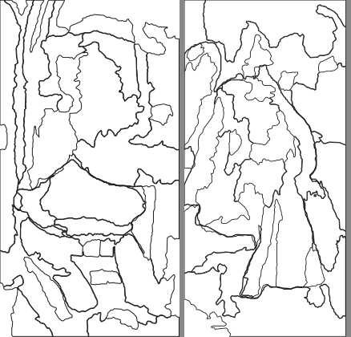
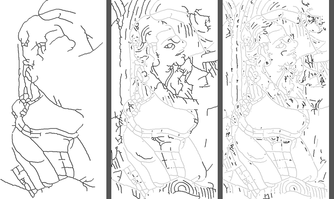
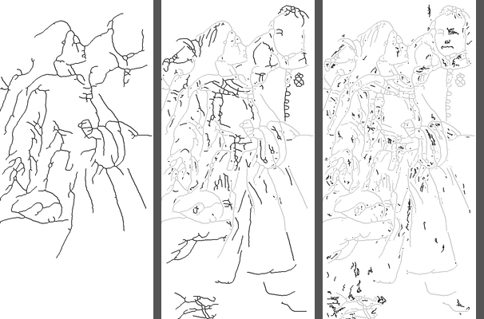
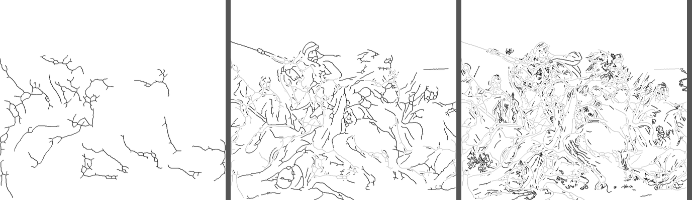

# Rencana: Tutorial Bertahap (3 fase, ±16 langkah)

> Status: **usulan, belum dikerjakan, belum disepakati dengan Xavier.**
> Diperbarui: 25 November 2026. Sumber: `RISET_TUTORIAL.md` (riset Xavier + Iqbal, commit `5a65056`) dan prototipe garis lokal (23 Nov).
> Dasar teknis: PR #43 (kontur dulu, detail belakangan; masih terbuka).

## 1. Masalah

Dicoba langsung di "Sawah Berundak":

- Tahap sketsa langsung menampilkan semua garis sekaligus: gunung, batas pohon, dan semua lengkung sawah, di grid 6×4.
- Satu tahap warna berisi 18 bidang, masing-masing dengan resep 3 cat, jadi ada 18 campuran dalam satu tahap.
- Satu tahap memakan ±30–60 menit. Terlalu banyak hal baru sekaligus untuk pemula, jadi mereka tidak tahu harus mulai dari mana.

Sebelum PR #43 lebih parah lagi: lapisan sketsa diambil dari batas gumpalan warna, jadi bentuknya tidak mengikuti tokoh.

## 2. Dasar riset (ringkas dari `RISET_TUTORIAL.md`)

| Prinsip | Bukti | Dampak ke desain |
|---|---|---|
| Pecah jadi langkah kecil, satu hal baru per langkah | Rey dkk. 2019 (meta-analisis segmentasi); Sweller dkk. 2019 | ±16 langkah; maks ±5 region baru per langkah |
| Urutan: patokan → bentuk kasar → kontur → nilai → detail | DrawMyPhoto (Williford dkk. 2019); Iarussi dkk. 2013; How2Sketch 2017 | Fase sketsa 7 langkah dengan 3 tingkat garis + titik patokan |
| Kesalahan menggambar terutama dari salah melihat | Chamberlain & Wagemans 2016 | Zoom ke kotak grid, titik patokan, overlay acuan |
| Bantuan diminta, lalu dikurangi | Harms dkk. 2011; Renkl & Atkinson | Mode jiplak opsional, bukan default |
| Animasi efeknya kecil–sedang | Höffler & Leutner 2007; Berney & Bétrancourt 2016 | Animasi garis pendek per langkah, bisa diulang |
| Feedback di titik kunci saja | Williford dkk. 2019 | Tetap 2 checkpoint foto |

Angka langkah, menit, "maks 5 region", dan "maks 6 campuran" adalah **heuristik** (riset menandainya sebagai celah bukti). Harus diuji ke 3–5 orang.

## 3. Struktur baru untuk pengguna

### Fase 1: Sketsa (7 langkah)

| # | Langkah | Lapisan / bantuan | Asal data |
|---|---|---|---|
| 1 | Siapkan alat + bidang | Daftar alat | Teks |
| 2 | Grid tipis di bidang | Grid + ukuran kotak dalam cm | `grid.svg` (sudah ada) |
| 3 | Titik patokan: 3–5 titik kunci | Titik bernomor + nama kotak grid-nya | **baru**: `landmarks.svg` (§4.2) |
| 4 | Bentuk kasar objek utama | Garis *block-in* sangat sederhana | **baru**: `sketch_coarse.svg` (§4.1, tingkat 1) |
| 5 | Garis besar latar (cakrawala, batas bidang besar) | Garis tingkat 1 untuk latar | **baru**: bagian latar dari tingkat 1 |
| 6 | Perhalus kontur, satu area grid per kali | Garis tingkat 2, zoom per kotak | `sketch.svg` (PR #43) |
| 7 | Cek sketsa → **checkpoint foto 1** | Overlay acuan | Checkpoint sketsa (sudah ada) |

Mode jiplak (opsional, diminta pengguna): garis seukuran bidang untuk ditransfer dengan kertas karbon. Lihat keputusan §11.

### Fase 2: Warna (±6 langkah, tergantung jumlah campuran)

| # | Langkah | Isi |
|---|---|---|
| 8 | Siapkan campuran 1: campur, uji di kertas | 1 resep + swatch |
| 9–12 | Warnai semua bidang campuran 1, lalu campuran 2, dst. (belakang ke depan, besar ke kecil) | **Maks 6 campuran total, satu campuran per langkah** (§4.4) |
| 13 | Terang-gelap: 3 tingkat (terang, sedang, gelap). **Lipatan dan volume diajarkan di sini**, bukan sebagai garis (§4.5) | Lapisan `value` |
| | → **checkpoint foto 2** setelah warna dasar | |

### Fase 3: Finishing (3 langkah)

| # | Langkah | Isi |
|---|---|---|
| 14 | Bidang kecil + garis detail terpilih | Garis detail (§4.3): hanya garis yang memang garis di karya asli |
| 15 | Aksen: highlight dan bagian tergelap | Lapisan `value` |
| 16 | Bandingkan dengan foto asli, rapikan | Foto asli + overlay |

Total 14–18 langkah: karya sederhana dengan sedikit campuran → lebih sedikit langkah warna.

## 4. Cara menghasilkan datanya (backend, tanpa AI)

### Tingkat garis

| Tingkat | Nama | Dipakai di langkah | Isi |
|---|---|---|---|
| 1 | Bentuk kasar | 4–5 | ±5–15 garis panjang: siluet tokoh utama dan bentuk terbesar |
| 2 | Kontur | 6 | Kontur lengkap: wajah, tangan, tepi baju, objek kedua |
| 3 | Garis detail | 14 | Hanya garis yang memang digoreskan di karya asli |

Setiap tingkat hanya menampilkan **garis baru** dengan warna hitam. Garis tingkat sebelumnya tampil abu-abu.

#### Prototipe (lokal, 23 Nov)

Kiri ke kanan: tingkat 1 bentuk kasar | tingkat 2 kontur | detail. Garis lama abu-abu, garis baru hitam.

- **Bali dan Diponegoro**: tingkat 1 sudah terbaca sebagai bentuk tokoh.
- **Perburuan Singa** (adegan ramai): tingkat 1 masih bercabang. Perlu perbaikan di §4.1 poin 3.

### 4.1 Tingkat 1: bentuk kasar

1. Peta tepi dari gambar sangat kecil: `edge_map(img, method, resolution=160)` (TEED kemungkinan butuh ±224; diuji seperti di PR #43).
2. `outline_lines()`, lalu simpan **hanya garis panjang**: kotak pembatasnya ≥12% sisi terpanjang gambar.
3. **Adegan ramai**: tambahkan siluet objek utama (`mask` u2net) yang disederhanakan dengan `cv2.approxPolyDP` (epsilon ±1,5% keliling), supaya yang tergambar bentuk geometris besar, bukan cabang-cabang.
4. Bila lebih dari ±25 garis, naikkan batas panjang bertahap.
5. Pisahkan garis **objek utama** (di dalam/menempel `mask`) untuk langkah 4, dan garis **latar** untuk langkah 5.

### 4.2 Titik patokan

1. Kandidat: titik ujung dan sudut tajam garis tingkat 1, puncak siluet objek utama (titik teratas, terkiri, terkanan), dan garis cakrawala bila ada garis horizontal panjang.
2. Pilih 3–5 titik yang tersebar (jarak minimum antartitik ±20% sisi gambar), utamakan titik di siluet objek utama.
3. Simpan nomor, koordinat, dan nama kotak grid (mis. "B3") untuk tiap titik. Nama kotak dipakai teks instruksi.
4. Lapisan `landmarks.svg`: lingkaran bernomor.

### 4.3 Tingkat 3: garis detail terpilih

Mulai dari garis detail histeresis PR #43 (`clean_lines`), dikurangi tingkat 1 dan 2, lalu dipilah per segmen:

1. Ambil profil kecerahan foto (kanal L, LAB) tegak lurus garis, ±4 px ke kiri dan kanan.
2. **Garis sungguhan**: lebih gelap dari *kedua* sisinya (misal ΔL ≥ 8). Dipertahankan.
3. **Tepi nada**: satu sisi gelap, sisi lain terang. Ini lipatan/bayangan → **dibuang**, karena diajarkan lewat pewarnaan (§4.5).
4. Segmen pendek yang tersisa ikut dibuang.
5. Karya datar (`use_shading = false`, mis. Kamasan/Bali): langkah 3 dilonggarkan, karena gayanya memang menggambar lipatan sebagai garis tipis gelap.

| Jenis garis | Contoh | Diajarkan lewat |
|---|---|---|
| Tepi antara dua nada warna | Lipatan jubah, bayangan leher, otot kuda | Pewarnaan (langkah 13, 15) |
| Garis tipis gelap, sisi kiri-kanan lebih terang | Mata, alis, motif kain, kontur wayang | Garis detail (langkah 14) |
| Tekstur kecil berulang | Serat kanvas, sapuan kuas, rumput | Tidak diajarkan |

**Belum diprototipe.** Uji di Diponegoro (lipatan jubah hilang, wajah tetap) dan Bali (motif dan lipatan bergaris tetap).

### 4.4 Maks 6 campuran

Sekarang: CV memakai 12 warna dan sampai 35 region, dan **tiap region punya resep sendiri** (`region_colors` per palet).

Usulan:

1. Warna region tetap dari CV, jadi kualitas region tidak turun.
2. Kelompokkan warna target region jadi **maks 6 campuran**: k-means di ruang LAB dengan bobot luas region, lalu hitung resep (`color/mixer.py`) untuk tiap pusat kelompok.
3. Tiap region diberi `mix_id`. Simpan ΔE antara warna asli region dan campurannya. Bila ΔE terlalu besar untuk region penting (objek utama), beri catatan "campur sedikit lebih gelap/terang" di kartu.
4. Urutan campuran: dari bidang paling belakang/terbesar ke paling depan/terkecil.
5. Satu langkah warna = satu campuran: semua region dengan `mix_id` itu. Bila satu campuran punya >±5 region besar, langkahnya dibelah dua (heuristik riset).

### 4.5 Lipatan dan volume lewat pewarnaan

- Karya bergradasi (`use_shading = true`, mis. Raden Saleh): lipatan diajarkan di langkah 13 "Terang-gelap" (lapisan `value`; usul riset 3 tingkat, sekarang 4). Teksnya menyebut lipatan secara eksplisit, mis. "Gelapkan bagian dalam lipatan jubah; biarkan punggung lipatan tetap terang."
- Bidang warna sudah memisahkan bagian gelap/terang lipatan besar. Yang berubah hanya teks instruksinya.

### 4.6 Teks instruksi (AI)

- Satu panggilan `stage_text` untuk semua langkah, dengan instruksi **pendek** yang menyebut **kotak grid** (mis. "Mulai dari kotak A2").
- Nama kotak diambil dari data CV (`grid_cells` tiap langkah, titik patokan), **bukan dikarang AI**. Validator menolak nama kotak yang tidak ada di data.
- Templat cadangan untuk setiap jenis langkah baru.
- Biaya: ±$0,011 → **±$0,018–0,02 per tutorial** (input ±7.500 token, output ±2.000 token, terra). Detailnya ada di perhitungan usage sebelumnya.

## 5. Perubahan data dan API

### 5.1 Database (migrasi baru)

| Objek | Sekarang | Perubahan |
|---|---|---|
| `stages.order_no` | `check (order_no between 1 and 8)` | Jadi 1–20 |
| `stage_kind` enum | 8 jenis (preparation, sketch, background_and_largest, …) | Tambah: `grid`, `landmarks`, `block_in`, `background_lines`, `contour`, `sketch_check`, `color_prep`, `paint_mix`, `accents`, `compare` |
| `stages` | – | Kolom baru `phase` (sketch/color/finishing), `mix_id`, `grid_cells text[]` |
| `layer_kind` enum | grid, lineart, main_object, regions, value, sketch, … | Tambah `landmarks`, `block_in`, `background_lines` |
| Tabel baru `lesson_mixes` | – | Campuran per lesson+palet: `mix_id`, `order_no`, `target_hex`, resep, ΔE |
| `regions` | – | Kolom `mix_id` |
| Fungsi `create_lesson` | Menyimpan kolom sekarang | Ikut menyimpan kolom/tabel baru |

### 5.2 API dan batas lain

- `GET /lessons/{id}`: `stages[]` mendapat `phase`, `mix_id`, `grid_cells`; tambah `mixes[]` dan `landmarks[]`.
- `routes/sessions.py`: `current_stage_order` sekarang `le=8` → dinaikkan.
- Cek progres dan checkpoint yang bergantung pada jenis tahap (`checkpoints.py`, `progress.py`, `stage_planner._assign_checkpoints`).

### 5.3 Dokumen dan contoh (dikerjakan PERTAMA)

- `api/examples/lesson_detail.json`: contoh lengkap struktur baru (fase, langkah, tingkat garis, patokan, campuran). **Diminta Xavier lebih dulu** untuk mock frontend.
- `api/API.md`: deskripsi field baru + aturan kompatibilitas (§7).

## 6. Perubahan per berkas

### Backend (`api/`, Iqbal)

| Berkas | Perubahan |
|---|---|
| `supabase/migrations/…_tutorial_bertahap.sql` | §5.1 |
| `cv/stage_planner.py` | Ditulis ulang: 3 fase, `MAX_STAGES` ±18, `MAX_REGIONS_PER_STAGE` 10 → 5, langkah warna per campuran, checkpoint di langkah 7 dan setelah warna dasar |
| `cv/lineart.py` | `coarse_lines()` (§4.1), `select_detail_lines()` (§4.3) |
| `cv/landmarks.py` (baru) | Titik patokan (§4.2) |
| `cv/render.py` | `sketch_coarse_svg`, `landmarks_svg` |
| `cv/pipeline.py`, `cv/types.py` | Langkah `coarse` dan `landmarks`, field baru di `CvResult`, dicatat di `timings_ms` dan log `cv_stage` |
| `color/palettes.py`, `color/mixer.py` | Pengelompokan maks 6 campuran (§4.4) |
| `services/lessons.py` | Unggah lapisan baru, payload campuran |
| `ai/prompts/stage_text.v1.md` → `v2`, `ai/schemas.py`, `ai/validators.py`, `ai/templates.py` | §4.6 |
| `routes/lessons.py`, `routes/sessions.py`, `routes/checkpoints.py`, `routes/progress.py` | §5.2 |
| `tests/` | Planner (jumlah langkah, maks region), garis (jumlah tingkat 1, tidak mengulang), campuran (≤6, ΔE), validator kotak grid |

### Frontend (`web/`, Xavier)

| Fitur | Catatan |
|---|---|
| Header 3 fase + progres langkah | |
| Animasi garis tergambar per langkah | Bisa diulang; hormati `prefers-reduced-motion` |
| Zoom ke kotak grid aktif + titik patokan | Dari `grid_cells` dan `landmarks` |
| Garis lama abu-abu, garis baru hitam | |
| Kartu satu campuran per langkah | Dari `mixes[]` |
| Mock dev untuk bentuk data baru | Dari `api/examples/lesson_detail.json` |
| Tetap mendukung lesson lama (8 tahap) | §7 |

## 7. Kompatibilitas dan data lama

- Lesson lama (koleksi v2 dan hasil upload pengguna) tetap 8 tahap tanpa `phase`. Frontend menampilkan tampilan lama bila `phase` tidak ada.
- Sesi yang sedang berjalan tidak dipindah ke struktur baru.
- Materi koleksi di-impor ulang setelah backend selesai (biaya teks AI ±$0,10 untuk 5 materi).

## 8. Pengujian dan kriteria selesai

- [ ] Total 14–18 langkah untuk kelima materi koleksi dan 2 foto upload.
- [ ] Tidak ada langkah dengan lebih dari ±5 region baru; tidak ada langkah warna dengan lebih dari 1 campuran.
- [ ] Maks 6 campuran per lesson; ΔE per region dicatat.
- [ ] Tingkat 1 berisi ±5–25 garis dan terbaca sebagai bentuk besar (dicek visual, gambar disimpan di `eval/`).
- [ ] Tingkat 2 tidak mengulang garis tingkat 1.
- [ ] Garis detail Diponegoro/Perburuan Singa: lipatan dan bayangan hilang, mata/alis/mulut/jari tetap. Bali: motif dan lipatan bergaris tetap.
- [ ] Titik patokan 3–5 per gambar, nama kotak grid benar.
- [ ] Teks AI hanya menyebut kotak grid yang ada di data.
- [ ] Checkpoint sketsa tetap lolos uji nyata (`eval/HASIL_CHECKPOINT_NYATA.md`, 20/20).
- [ ] RAM worker Railway tetap di bawah 1 GB (log `cv_stage`, puncak sekarang ±966 MB).
- [ ] Lesson lama tetap bisa dilatih.
- [ ] Tes API dan web (`pytest`, `vitest`, typecheck, lint) lolos.
- [ ] Uji ke 3–5 orang dengan satu materi: catat di langkah mana mereka berhenti atau bingung.

## 9. Risiko

| Risiko | Mitigasi |
|---|---|
| Tingkat 1 bercabang di adegan ramai | Siluet objek utama disederhanakan (§4.1 poin 3); bila gagal, tingkat 1 hanya siluet |
| Pemilahan garis membuang garis penting | Ambang ΔL dikalibrasi di 5 karya; garis tingkat 1–2 tidak pernah dibuang; karya datar dilonggarkan |
| Pengelompokan 6 campuran membuat warna melenceng | ΔE dicatat; region objek utama diberi catatan penyesuaian; batas 6 bisa dinaikkan bila uji pengguna menunjukkan perlu |
| Tidak ada objek utama (batik, pemandangan) | Tingkat 1 hanya dari garis panjang; langkah 4 digabung ke langkah 5 |
| Skema DB berubah besar | Migrasi diuji di project dev dulu; lesson lama tetap terbaca |
| RAM worker bertambah | Inferensi tambahan kecil (≤224 px); peta tepi dilepas setelah dipakai |
| Waktu sebelum showcase sempit | Dikerjakan **setelah 27 Nov** (§10) |

## 10. Jadwal

### Jalur showcase (sampai 27 Nov)

| Hari | Pekerjaan |
|---|---|
| 25–26 Nov | Merge PR #43 (kontur dulu, detail belakangan). Re-import 5 materi koleksi ke produksi (v3). Cek RAM worker. Uji di HP |
| 27 Nov | Showcase |

### Jalur tutorial bertahap (setelah 27 Nov)

| Urutan | Pekerjaan | Perkiraan |
|---|---|---|
| 1 | Contoh JSON + `API.md` (Xavier bisa mulai mock) | 1–2 jam |
| 2 | Migrasi DB + `create_lesson` + route | ½ hari |
| 3 | Tingkat garis 1 + titik patokan + pemilahan detail | ½ hari |
| 4 | Pengelompokan campuran + planner 3 fase | ½ hari |
| 5 | Prompt AI v2 + templat + validator | ¼ hari |
| 6 | Uji 5 materi + 2 upload, re-import koleksi | ¼ hari |
| 7 | Uji ke 3–5 orang | 1 sesi |

Total backend ±1,5–2 hari (riset memperkirakan 1–1,5). Frontend Xavier ±1 hari, paralel setelah langkah 1.

## 11. Keputusan yang perlu disepakati (dengan Xavier)

1. **Contoh JSON duluan**: usulan setuju; Iqbal menulisnya pertama.
2. **Total langkah**: usulan 14–18, dengan jumlah langkah warna mengikuti jumlah campuran.
3. **Waktu**: usulan **setelah 27 Nov**; showcase memakai PR #43 + re-import saja.
4. **Mode jiplak / PDF seukuran bidang**: usulan ditunda; riset sendiri menyebutnya opsional dan diminta.
5. **Karya datar bergaya garis** (Bali/Kamasan): lipatan bergaris tetap jadi garis detail (usulan), atau dibuang demi kesederhanaan?
6. **Karya tanpa objek utama** (batik, pemandangan): langkah 4 digabung ke langkah 5 (usulan), atau tetap terpisah?
7. **Terang-gelap**: 3 tingkat (usul riset) atau tetap 4 tingkat seperti sekarang?
